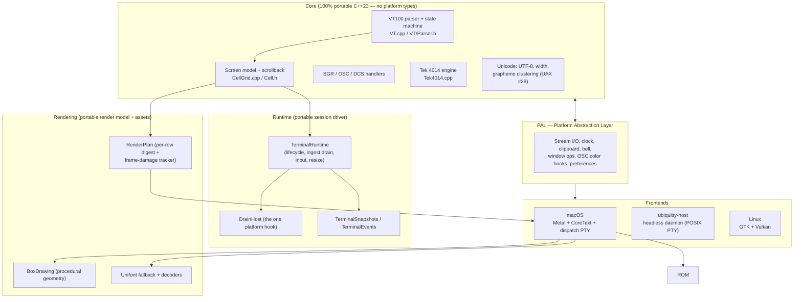
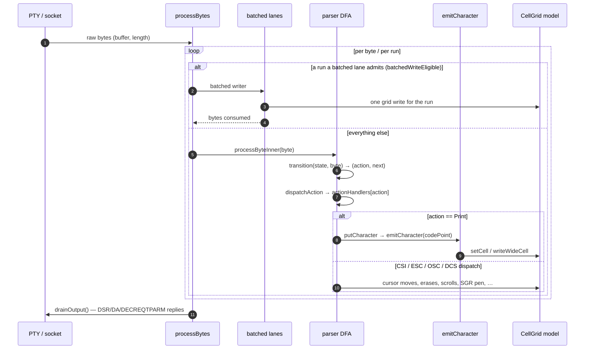
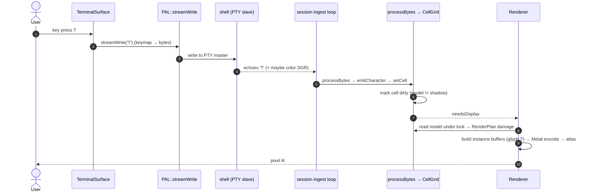

<!-- Copyright (C) 2026 Stanislav Yaglo -->
<!-- SPDX-License-Identifier: Apache-2.0 -->

# Ubiquitty — Architecture & Pipeline

> An end-to-end map of how Ubiquitty is structured and how a byte travels from a
> pseudoterminal to a lit pixel. References name a file and a symbol, never a
> line number: a line number is right on the day it is written and silently wrong
> after the next edit, and `Scripts/check-doc-references.py` holds both halves of
> that to the tree. Diagrams are Mermaid (renders on GitHub) plus ASCII where a
> fixed layout reads better.

The driving rule is one sentence:

> **No platform-specific API — no Cocoa, no Metal, no AppKit, no GTK, no
> Vulkan — may appear in Core or in any shared, host-tested translation unit.
> Platform code lives only behind the PAL seam, in a platform directory.**

Everything below is the structure that makes that rule true and *checkable*
rather than aspirational.

The second rule draws the line between **compatibility** and **design**:

> **If a program can observe it, it is compatibility: it lives in the Core model, stays bug-for-bug, and the terminal model owns it. If only a human sees it, it is design: it lives in presentation, and the frontend owns it.**

The two never trade against each other because they live in different layers. A program observes the terminal only through what it can write and read back: the cursor position, the cell grid and its attributes, mode state (autowrap, origin, insert, the DEC private modes), the scroll region, tab stops, charset designations, the saved cursor, and every reply the terminal sends (DSR/CPR, DECRPM, DA, DECRQSS). That surface is **fidelity** — the pending-wrap latch that defers the last-column wrap, `DECSCNM` reverse-screen, the national replacement charsets, the modes a legacy VT host still leans on: a program may depend on any of them, so the Core reproduces them exactly, quirks included. Removing or "fixing" an observable quirk is a compatibility regression, never a cleanup.

What a human sees but no program can read back is **design**: the font and its metrics, the cursor's shape within what `DECSCUSR` selected and the motion of its move, selection and hover affordances, the rendering of a palette the program set by name, spacing, and every animation. The renderer is free to make these beautiful without ever changing what a program observes.

Font fallback and language/script routing follow the same boundary. The terminal
Core decides characters, grapheme clusters, attributes, and cell widths;
`Source/Core/Rendering` owns the portable route policy that maps those cells to
font-route intent; `Source/Platform/{macOS,Linux}` owns the local font inventory
and platform text APIs; renderers such as `SurfaceRenderer` consume route decisions
and keep rasterization, atlas, and draw submission ownership. The detailed
contract lives in `Docs/font-routing.md`.

The test for any "clean this up" proposal is one question — **can a program observe it?** If yes, it is compatibility and it stays (Core owns it). If only a human sees it, it is design (the frontend owns it). This is the model-side counterpart of the platform/PAL boundary: the Core holds program-observable behavior; the frontend holds what is purely seen. `Docs/coding-conventions.md` carries the engineering conventions.

> **Remote-Core architecture:** the terminal Core runs locally or in
> `ubiquitty-host` as a persistent multiplexer, with thin native clients
> attaching over the sync protocol. `session-model.md` and `sync-protocol.md`
> describe that product contract; the [remote-Core multiplexer](#9a-the-remote-core-multiplexer)
> section maps the implementation surfaces.

---

## 1. What Ubiquitty Is

Ubiquitty is a **portable C++23 terminal emulator** built around one rule: all
terminal *behavior* lives in a platform-agnostic Core; each platform supplies
only a thin drawing-and-I/O shell. The same Core compiles for:

| Frontend | Platform | Graphics | I/O |
|----------|----------|----------|-----|
| **macOS** | modern macOS / Apple Silicon | Metal + CoreText | `forkpty` PTY, Unix sockets, TCP |
| **ubiquitty-host** | headless daemon (macOS / Linux) | — | POSIX PTY |
| **Linux** | GTK frontend | GTK + Vulkan | local POSIX PTY today; host / sync attach path shares the same Core |
| **iOS** | iphoneos / iphonesimulator | Metal + CoreText (the Apple-shared Swift layer) | no local PTY: the platform runs no child process, so a session arrives over the delegated carrier |

The cross-platform forcing function is the **Linux/GTK frontend +
ubiquitty-host**: that is what keeps Core free of Darwin-only libc and platform
types.

### Design philosophy

1. **Portable-first.** Functionality is driven from shared Core/Rendering; the
   frontends are thin and reusable. A new port reimplements one renderer seam
   and one hook table (the PAL), and inherits everything else.
2. **One model, computed dirtiness.** The screen is a single cell array plus a
   painted "shadow"; dirty regions are *derived* by diffing, not tracked by a
   web of flags. Guaranteed in-sync at every frame boundary.
3. **Optimize aggressively, stay clean.** Hot paths are batched and
   SIMD/SWAR-accelerated, but the acceleration is portable (libc `memcmp`/
   `memcpy`, endianness-independent SWAR) and isolated behind clear seams.

---

## 2. Layered Architecture



### Source tree

The source tree maps to that layering directly. Every top-level directory and
every `Source/Core/` module is listed:

```
Source/
├── Base/            portable primitives below everything else: CheckedPtr and
│                    WeakPtr, fallible strings and vectors, ByteBuffer,
│                    geometry, bit fields and option sets, compiler and
│                    toolchain floors, Swift interop annotations.
├── PAL/             the platform seam Core depends on.
│   ├── PAL.h        the platform contract.
│   ├── PAL.cpp      portable hook storage + dispatch (host-testable).
│   ├── TaskQueue.{h,cpp}
│   │                inline submit-then-drain job queue.
│   └── OutputQueue, TerminalClients.h, Stream.h, Socket.h, Poll.h,
│                    Process, file descriptors, durable and bounded files,
│                    sealed storage: portable platform-level pieces shared
│                    across frontends.
├── Core/            the portable terminal model, and every portable layer it
│   │                rests on. Depends on Base, PAL, the vendored ThirdParty
│   │                libraries, and its own modules — nothing else.
│   │                Top level: the Terminal facade and its operations, the
│   │                cell/grid model (Cell, CellGrid, pens, palettes),
│   │                scrollback (LineStore), SGR, terminfo.
│   ├── VT/          the Williams-style DFA and its dispatch: CSI, escape,
│   │                prefixed (DEC private) sequences, modes, reports.
│   ├── Screen/      screen state, scroll regions, reflow, the scroll lane.
│   ├── Modes/       terminal mode state: emulation dialect, focus reporting,
│   │                scrolling, synchronized output, and what the host may
│   │                change (HostPolicy).
│   ├── Cursor/      cursor style, blink, and render state.
│   ├── OSC/         OSC dispatch: clipboard, color, shell integration,
│   │                notifications, iTerm2 extensions.
│   ├── Attributes/  hyperlinks and the link runs that carry them.
│   ├── Unicode/     UTF-8 decode + width tables + UAX #29 clustering, Arabic
│   │                cursive shaping (pure data + tables).
│   ├── RichText/    rich-text documents: blocks, layout, drawing, RTF reader.
│   ├── Selection/   selection model (pure data).
│   ├── Themes/      color schemes + cell-color resolution (pure data).
│   ├── Accessibility/ colorblind palettes and the screen's text projection.
│   ├── Image/       inline-image models and decoders: Sixel, TIFF/iTerm2
│   │                placement and storage.
│   ├── Kitty/       the kitty graphics protocol model and decoder.
│   ├── Tek/         Tektronix 4014 storage-tube vector mode.
│   ├── Keys/        key events, keymaps, key translation, and the kitty
│   │                keyboard protocol encoder.
│   ├── Input/       keybindings, the compose engine, the pointer ladder and
│   │                pointer reporting policy, and the paste rewrite
│   │                (PasteNormalize).
│   ├── Mouse/       mouse reporting, the DEC locator, hilite tracking (1001).
│   ├── Clipboard/   staged clipboard reads and clipboard tool invocation.
│   ├── Protocol/    the separable wire protocols (Protocol:: tier) — portable:
│   │   ├── Tmux/    the tmux control-mode protocol model
│   │   │            (Protocol::Tmux) — runs over a local PTY, not a network.
│   │   ├── Sync/    the serializable Core↔client sync protocol
│   │   │            (Protocol::Sync, NativeAttachment) for the remote-Core /
│   │   │            ubiquitty-host split + QUICBootstrap (the token-mint
│   │   │            control sub-exchange). The wire is the same state the
│   │   │            renderer already snapshots.
│   │   ├── Control/ the control-socket server and the method registry
│   │   │            shared with ubq and its MCP tools.
│   │   └── Local/   same-machine wires: handoff, adoption, reclaim,
│   │                clipboard. ControlRPC is the JSON-RPC envelope.
│   ├── Network/     portable network-adjacent helpers: file-transfer detection
│   │                and remote-launch policy.
│   ├── Transport/   channel abstractions and carriers for local sockets,
│   │                subprocess/SSH, poll-driven streams, and QUIC.
│   ├── Panes/       the pane split tree (PaneTree) and divider paths.
│   ├── Session/     portable workspace/session/tab/pane model, deploy policy,
│   │                foreground-process selection (ProcessSubtree), and
│   │                RemoteSessionCore (the sync client state machine).
│   ├── Runtime/     portable C++23 runtime above Core+PAL: TerminalRuntime
│   │                (lifecycle, ingest drain, host-byte feed/echo, reply
│   │                flush, input routing, resize, focus) + DrainHost (its
│   │                only platform hook) + the serializable snapshot/event
│   │                surfaces (TerminalSnapshots, TerminalEvents).
│   ├── App/         portable application-runtime glue: AppRuntime, welcome
│   │                screen, session outlines, title composition.
│   ├── Title/       title formatting, truncation, and directory display.
│   ├── CommandPalette/ the command palette engine: registry, fuzzy matching,
│   │                frecency, settings commands.
│   ├── Security/    agent policy, the injection gate, consent text, secure
│   │                input policy.
│   ├── Terminfo/    UbiquittyTerminfo (portable terminfo description).
│   ├── Rendering/   portable paint model + raster helpers: RenderPlan (per-row
│   │                digest + frame-damage tracker), CellInstanceBuilder (the
│   │                GPU instance stream every frontend consumes), glyph atlas /
│   │                slot cache, font metrics, box-drawing geometry, and the
│   │                Unifont fallback. All portable; pixel-pushing lives in the
│   │                frontends.
│   ├── Codec/       PNG, zlib, Base64, JSON, and the wuffs image codecs.
│   ├── Crypto/      HMAC and SHA-256 for capability tokens and digests.
│   ├── Triggers/    portable output-matching rule engine + smart selection.
│   ├── Diagnostics/ portable perf counters (PerfCounters, PerfDiag), frame
│   │                perf logs, paint heatmaps.
│   └── Preferences/ declarative TOML config + profiles (Preferences, Profile —
│                    portable; every frontend reads them).
├── ThirdParty/      vendored re2, simdutf, wuffs, xxhash, yyjson.
├── Forward.h        shared forward declarations for cross-module headers.
├── Agent/           ubq headless client + MCP server.
├── UbiquittyCore/   the libUbiquittyCore embedding surface.
├── UbiquittyKit/    the embedding SDK over the serializable seam — a GUI, ours
│                    or a third party's, builds a terminal app on Core. Not a
│                    plugin loader: nothing dlopens anything (Docs/ubiquittykit-api.md).
├── UbiquittyRenderKit/
│                    the Swift + Metal renderer the macOS and iOS apps share:
│                    font routing, glyph rasterization and atlas, frame
│                    encoding, shaders.
└── Platform/        the per-frontend backends that implement the PAL seam.
    ├── Apple/       code the macOS and iOS apps share: SSH, CoreFoundation
    │                ownership helpers, the clock, Metal texture limits.
    ├── POSIX/       PTYStream and the POSIX PAL pieces shared by the
    │                Unix backends.
    ├── Host/        the ubiquitty-host daemon: runs Core headless
    │                (Daemon, HostPAL, HostPaths, main).
    ├── Linux/       the GTK4 + Vulkan frontend.
    ├── Web/         the WebGL frontend: WebTerminal + a JS host page, over
    │                the same CellInstanceBuilder stream.
    ├── Wasm/        the WebAssembly PAL backing that frontend.
    ├── Wscons/      the OpenBSD/NetBSD console frontend — no toolkit, no GPU.
    ├── Emacs/       ubiquitty-sync.el, a Sync client with no C++ linked at
    │                all: the protocol seam's independent proof.
    ├── Neovim/      ubiquitty_sync, the same seam in Lua: a terminal buffer fed
    │                through the host's attach bridge.
    ├── iOS/         the SwiftUI iPhone/iPad app, over the portable Core and
    │                UbiquittyRenderKit; SSH and QUIC remote sessions,
    │                with device and simulator builds (Scripts/build-ios.sh).
    └── macOS/       the AppKit app: windows, Swift chrome, the runtime
                     bridge, the thin remote client, and the macOS PAL
                     implementations; it draws through UbiquittyRenderKit.
```

**The two seams that make this portable:**

- **PAL** (`Source/PAL/PAL.h`) — a flat table of C-style function pointers.
  Core calls *up* through it (write to PTY, ring bell, set clipboard, resize
  window, report cwd). Every hook is nullable; an unset hook is a silent no-op.
- **Render model** (`Source/Core/Rendering/RenderPlan.h`) — a portable per-frame
  grid snapshot plus per-row damage tracker. The platform renderer consumes it
  and owns the GPU binding; no platform draw call lives in Core.

### What "portable" means, concretely

A translation unit is **portable** when it compiles and links against nothing
but `Source/` (resolved via `-I Source`), `Base/Types.h`'s integer aliases, and
other portable TUs. The host test suite is the enforcement mechanism: a portable
TU is one that builds under the host clang with no platform framework — no
Cocoa/Metal, no GTK/Vulkan, no POSIX-only surface beyond what the daemon's own
portable code uses.

No Core header includes any Apple header. Primitives are spelled with the
standard `<cstdint>` names (`uint8_t`, `int32_t`, …) throughout —
`Source/Base/Types.h` is the one include Core pulls to guarantee them on every
host. A Linux host build of the Core pulls no Apple header. A frontend is
defined by exactly two things: the PAL functions it implements, and the hooks it
installs.

---

## 3. The Data Model (Core)

Three structs carry everything. All are **zero-padded and `memcmp`-comparable**,
which is what unlocks the bulk SIMD operations later. For the exhaustive
type-to-header index, see `architecture-type-map.md`.

### Cell — 32 bytes (`Source/Core/Cell.h`)

```c
struct Cell {
    uint32_t codePoint;             // canonical Unicode codepoint of the cluster base (0 = blank)
    Pen      pen;                   // 20 bytes of attributes + colors
    uint32_t combining[1];          // one inline grapheme-continuation codepoint
    uint8_t  linkIDLo, linkIDHi;    // OSC 8 hyperlink id (split to avoid padding)
    uint16_t clusterPacked;         // combining length (1 bit) + overflow cluster id (15 bits)
};                                  // static_assert(sizeof(Cell) == 32)
```

`combiningLength` and `clusterID` are accessors over `clusterPacked`, not fields:
read them as `cell.combiningLength()` and `cell.clusterID()`, and write them with
`setCombiningLength` / `setClusterID`, which preserve the other's bits. The raw
word is never read directly — one 16-bit store keeps `Cell` at 32 bytes and
leaves it zero-padded, which is what the `memcmp` equality probe below needs.

- `codePoint == 0` ⇒ blank. A wide glyph stores the codepoint in the lead cell
  with `Attribute::Wide`, and a sentinel continuation in the next cell, whose
  `codePoint` is `wideContinuationSentinelCodePoint` (`Core/CellContent.h`, zero)
  and whose pen carries `Attribute::WideContinuation`.
- The inline `combining[1]` slot holds the common base+1 cluster (a lone
  combining mark, a VS-15/16, a regional-indicator flag pair, a skin-tone
  base). Any longer cluster (keycaps, multi-mark stacks, big ZWJ emoji
  families) is interned in the cluster pool (`Core/ClusterPool.h`) and
  referenced by `clusterID`, so the cell stays 32 bytes and
  `memcmp`-comparable. The pool keeps a cluster's first 16 code points
  (`clusterPoolMaximumCodePoints`) and drops the rest. It dedups by content
  and never reuses an ID, so it holds at most 32,767 distinct sequences
  (`clusterPoolMaxEntries`) until a hard reset (RIS) empties it. Past that
  ceiling it refuses a sequence it does not hold: a new cell keeps only its
  base and inline mark, and a cell already showing a pooled cluster keeps that
  cluster without the new code point.

### Pen — 20 bytes (`Source/Core/Pen.h`)

```c
struct Pen {
    uint16_t attrs;                 // BOLD DIM ITALIC UNDERLINE BLINK REVERSE
                                    // HIDDEN STRIKE WIDE WIDE_CONT GRAPHIC EMOJI
                                    // PROTECTED OVERLINE FRAMED ENCIRCLED
    uint16_t foregroundIndex, backgroundIndex; // idx | colorDefault | colorRGB
    uint16_t underlineIndex : 9;
    SemanticRole semanticRole : 2;  // Output, Prompt, Input
    uint16_t isForegroundAssignedDefault : 1; // DECAC colour standing in
    uint16_t isBackgroundAssignedDefault : 1; // for the default (host only)
    uint16_t underlineReserved : 3; // zero
    uint8_t  foregroundR,G,B, backgroundR,G,B, underlineR,G,B; // RGB when idx==colorRGB
    uint8_t  underlineStyle;        // None single double curly dotted dashed
    uint8_t  extendedAttributes;    // ATTR_EXT_* flags that overflowed attrs
                                    // (blink-fast, variable weight)
    uint8_t  font;                  // font style (SGR 10-20) | proportional (SGR 26)
};
```

The trailing pair is live: `extendedAttributes` carries the flags that do
not fit the saturated 16-bit `attrs` (blink-fast, variable weight), and `font`
carries font style, proportional spacing, sized-text band, rich-text coverage and ECMA guarded-area membership. DEC protection remains in `attrs`. The struct is 20 bytes with no implicit padding. Every unused bit in both bytes must stay zero, because the cell-equality
`memcmp` probe compares them: a byte that is only *usually* zero makes two
visually identical cells compare unequal, and nothing in the type says so.

### Screen & Terminal (`Core/Screen/Screen.h`, `Core/Terminal.h`)

`Screen` is one display surface: cursor, scroll region (DECSTBM/DECSLRM),
current pen, DECSC/DECRC saved state, and the per-row `lineAttribute`
(DECDWL/DECDHL) and `lineWrapped` (soft-wrap join flags). Those last two are
read-through *views*, not storage: the bytes live in `CellGrid::m_rowMeta` as the
one store of record, so a row's metadata travels with the row through a scroll
rather than being kept in step by hand. `Terminal` owns **two** screens (primary +
alternate), the parser state, charset state (G0–G3, single-shift), UTF-8 decoder
state, grapheme-cluster accumulator, the `LineStore` scrollback, and a `display`
pointer to the `Ubiquitty::CellGrid`.

The live screens use 32-byte `Cell` values: each screen block is
`m_rowCapacity × m_columnCapacity × sizeof(Cell)`, heap-allocated and resized on
reflow (see the CellGrid section below). Scrollback does **not** retain every
character at that stride. `LineStore` keeps content-trimmed raw blocks near the
live tail and folds cold blocks into UTF-8 text plus separate pen runs and a
block-local pen table. Its memory includes row descriptors, raw or folded block
storage, and a bounded cache of decoded cells; it is not a full-width cell array
allocated for the entire history limit.

---

## 4. Ingest Pipeline — bytes to cells

This is the hottest path in the program. Entry point:
`Ubiquitty::processBytes(t, buf, len)` (`VT.cpp`).



### What the parser is handed: the stream's bytes

The bytes `processBytes` receives are what `PAL::Stream::read` returned, and for
a PTY they are the kernel's bytes with one addition. A terminal that turns an
interrupt character into a signal (`ISIG` on, `NOFLSH` off) discards the output
it has not yet handed over when it takes one, then echoes the character as `^`
and a letter (`ECHO` and `ECHOCTL` on). The program's output is cut wherever the
reader had got to, and the echo follows the cut directly.

`PTYStream` marks the cut. When a write to the PTY carries the terminal's
interrupt, quit or suspend character (`VINTR`, `VQUIT`, `VSUSP`) under those
four modes, the next read that begins with the echo is returned with one
cancel byte (`0x18`) ahead of it:

```
kernel:   … ESC [ 3 8 ; 5 |cut|  ^ C \r \n $
stream:   … ESC [ 3 8 ; 5      0x18 ^ C \r \n $
```

The cancel control abandons a control sequence or string in progress and is
ignored at ground, so the half sequence before the cut does not take the echo for its
continuation. Without the mark a lone `ESC` and the echo's `^` read as `ESC ^`,
a privacy message, and the parser consumed everything after it. The mark is
written only when the write carried such a character and the echo then heads a
read; an echo that heads none of the next eight reads stops being expected.

Everything downstream of the stream sees the marked bytes: the parser, the
session log, the raw byte tap, a recording made through the runtime. A tool
that reads a PTY of its own does not: `Tests/Corpus/sync/record.py` records the
kernel's bytes, so an entry in which a key script interrupts a program in
cooked mode would differ from what a host parses by that one byte. No current
entry does (each runs a full-screen program with `ISIG` off).

### What the program is handed: an interrupt does not queue

Input goes to the program through `PAL::Stream::writeAll`, which queues what
the kernel does not take and keeps its order. One character is not queued
behind the rest. A terminal whose input queue is full and holds a whole line
takes no further character at all, its interrupt included, so an interrupt
written in turn behind lines the program never read would wait for a read that
only the interrupt could bring about. The line discipline discards every
unread character when it takes an interrupt (`ISIG` on, `NOFLSH` off), so
whatever waits ahead of one is input the program will not read either way.

`PTYStream` applies that itself. When a write carries the interrupt, quit or
suspend character and input is still queued ahead of it, the stream discards
its queue and the terminal's unread input, and the character then goes in as
any other and is answered by the line discipline. Under `NOFLSH` nothing is
discarded: the signal is raised on the foreground group directly, the
character is spent, and the queued input is read in order afterwards.

Sync input uses a numbered, bounded pane queue (`Sync::PaneInputQueue`).
The daemon continues reading its control stream; the pane's input sink
refuses a write while the stream still holds one, so what the program is not
taking waits in the pane. A
key that signals is the one write handed to the stream regardless. The pane
asks the same line discipline what the key does, drops what it holds where the
terminal discards its own, and tells each client what it lost of its own
([Sync](sync.md)); the stream then lets the character past whatever
it and the terminal still hold. The two act on different queues from one
reading of the terminal's modes.

### The state machine (`VT/Parser.h`, `VT.cpp`)

The DEC/ANSI byte driver is a hand-written Williams-style DFA. Its switch-based
`transition(State, byte) → {Action, NextState}` function is pure (no side effects),
with a separate dispatch step. The states are `VT::Parser::State` (Ground,
Escape, CSI, OSC, DCS, APC, the VT52 sub-grammar, …) and the actions
`VT::Parser::Action`, named *VerbObject* (`Print`, `EnterEscape`, …).

Dispatch is a **function-pointer table**, `actionHandlers[]`
(`VT.cpp`), indexed by action. Final-byte dispatch differs by family. A plain
CSI final is looked up in `csiLookup`, built at compile time from the sorted
`csiHandlers` table. Prefixed CSI (`findCSIPrefixed`), ESC (`findEscape`) and
DCS (`findDCS`) binary-search their sorted tables. OSC (`findOSC`) walks its
table in `Ps` order with an early exit; the frequent codes — title, working
directory, colours — sit at the front.

### The batched lanes that bypass the per-byte DFA

Before the per-byte DFA, `processBytesImpl` hands runs of printable text and
CSI parameters to batched writers; `batchedWriteEligible` is the one predicate
that admits them, and each writer's contract is in its comment in `VT.cpp`.

### Character emission (`emitCharacter`, `VT.cpp`)

Handles width (1 or 2 cells via `Unicode::Width::forCodePoint`), grapheme-cluster
extension (UAX #29 — combining marks attach to the prior cell rather than
advancing), deferred wrap at the right margin, insert mode (IRM), and the
wide-cell pair protocol. The output is always a `CellGrid` mutation.

### Arabic cursive joining (`Source/Core/Unicode/Joining.{h,cpp}`)

A portable, table-driven Arabic (Syriac/N'Ko/…) cursive-joining engine: per-codepoint
`Joining_Type` (`ArabicShaping.txt`), contextual form resolution (isolated/initial/
medial/final from the nearest non-Transparent neighbours), and lam-alef ligation.
`shapeRun` rewrites a logical run to Unicode presentation-form codepoints in
place (`out` may alias `in`), so even a renderer without script shaping draws
connected glyphs; a collapsed lam-alef sets the alef cell to 0 (kept, not removed,
so grid indices stay stable). `isCursiveJoiner` is a cheap per-codepoint row gate
(skip the pass on rows with no cursive script).

BiDi reordering is **not** separate: `shapeVisualRow` in the same file does it.
The file carries a minimal bidirectional pass — strong-RTL, weak and neutral
classification (`isStrongRTL`, the N1 rule for whitespace, Arabic-Indic digits
as weak) and the run reversal those resolve. What is separate is full UAX #9:
embedding levels, directional isolates and overrides, and the paragraph
algorithm. Cursive glyph metrics and modern ligatures are separate concerns.
Design: `arabic-shaping-design.md`.

### Host-query replies

DSR / DA1 / DA2 / DA3 / DECREQTPARM handlers append to `Terminal::outputBuffer`
(`respond`, `VT.cpp`, gated by a `Ubiquitty::Capability`). The frontend drains it via
`drainOutput` and writes it back to the PTY — closing the request/response loop
that tools like `vttest` and shell prompts depend on.

---

## 5. The cell grid — screen model, scrollback, painting

`Source/Core/CellGrid.{h,cpp}`. This is where the "one model, derived dirtiness"
idea lives.

### Backing store + the row-pointer ring

```
Cell* m_screenStore[2]     heap Cell block per screen, sized
                           m_rowCapacity × m_columnCapacity (32 B/cell),
                           reallocated on reflow — not a fixed array
Cell** m_rowPtrs[2]        each entry → a row inside m_screenStore
                           (always a permutation of the backing rows)
int    m_rowOrigin[2]      where logical row 0 sits in m_rowPtrs
```

A scroll never moves cell bytes. A full-viewport scroll moves `m_rowOrigin`;
`scrollRegion` (`CellGrid.cpp`) **rotates row pointers** within a `[top,bot]`
band — O(shift) pointer swaps instead of an O(rows×cols) memmove.

At-bottom floods can take a deferred scroll lane (`Screen/Scroll.cpp`);
`Tests/Core/test_scroll_lane_differential.cpp` holds it to the ordinary path's
results.

### Bulk cell operations

`CellGrid`'s bulk writers (`setRowSpan`, `eraseRowRange`, `writeASCIIRun`,
`fillBlank`) keep cells zero-padded and `memcmp`-comparable; their comments in
`CellGrid.cpp` state each contract.

### Scrollback + the `viewOffset` invariant

History is a ring of `ScrollLine` descriptors (`Core/Screen/ScrollLine.h`)
over `LineStore` blocks. Each descriptor records its content length, wrap
state and row metadata, and borrows cells when read. Older blocks may be held
in a compact lossless form that readers never see (`Core/LineStore.h`).

The single function that unifies "what cell is visible at (row,col) given the
scroll position" is:

```
visibleCell(t, viewOffset, row, col)             Screen/Addressing.cpp
    absolute = scrollbackCount - viewOffset + row
    if absolute < scrollbackCount  → scrollback line  (history)
    else                           → cellAt(absolute - scrollbackCount, col)  (live)
```

**This is the central invariant for selection/copy.** Both the on-screen
highlight (`SelectionPainter`) and the copied text read cells through
`visibleCell` with the *current* `viewOffset`, so a copy taken while scrolled
back returns exactly the rows the user sees. (The alternate screen has no
scrollback, so its `viewOffset` is pinned to 0.) The round trip through
`viewOffset` is pinned by
`Tests/Core/Selection/test_selection_viewport_roundtrip.cpp`.

### Wheel-scroll policy (`Source/Core/Screen/ScrollTuning.{h,cpp}`)

The raw wheel-delta → lines mapping is identical on every frontend, so it is
portable Core, not the AppKit `scrollWheel:` handler. A frontend passes the
device delta and a sub-line `accum` to `linesForDelta`; the module folds in the
user's `[mouse]` tuning (`wheelLines` base × `wheelSpeed` multiplier, both
floored) and returns whole lines, leaving the fractional residual in `accum` so a
slow trackpad pan still advances a line over several ticks.

### Reflow on resize (`VT.cpp`)

On a column change, the primary screen (not the alternate) is **rewrapped**:
soft-wrapped logical lines are streamed through the new width, re-split, with the
cursor tracked by absolute cell ordinal so it lands on the correct cell
afterward. Output that overflows spills into scrollback.

A width reflow returns a checked allocation result before the resize commits
terminal dimensions, cursor metadata, or deferred-history markers. Destination
grid capacity and reflow scratch storage must both be available; a refusal
keeps the current picture and leaves a pending settle available for retry.

### Paint session — deriving dirty runs

The renderer drives a `PaintSession` (`CellGrid.cpp`):

```mermaid
sequenceDiagram
    participant R as Frontend renderer
    participant PS as PaintSession
    participant M as cells (model)
    participant SH as m_bbShadow (painted)

    R->>PS: beginPaint()
    loop pending scrolls
        PS-->>R: nextPendingScroll()  (band + dy)
        R->>R: blit-scroll backbuffer
        R->>PS: ackScroll()  → shadowShiftRows() keeps shadow in lockstep
    end
    loop dirty runs
        PS->>M: scan row; cell != shadow or selection-dirty?
        PS->>PS: extend run while same pen + same dirty state
        PS-->>R: nextDirtyRun()  (row, col0..col1, selectionOnly)
        R->>R: paint the run
        R->>PS: ackRun()  → memcpy cells→shadow
    end
    Note over PS,SH: dtor asserts every yielded run was ack'd;<br/>shadow now mirrors the window exactly
```

A per-row hint (`m_anyDirtyInRow[]`) gives an O(1) skip for untouched rows. The
shadow is a *single* buffer regardless of which screen is active; after an
alt-screen flip every row is marked dirty so the next paint's diff resurfaces
the whole screen.

---

## 6. The Runtime Layer (portable session driver)

`Source/Core/Runtime/` is the portable C++23 runtime that sits directly above Core
and PAL and below every frontend. It is the seam where "drive the emulator" is
expressed once, portably, instead of in each frontend:

- **`TerminalRuntime`** owns the per-session lifecycle: it drains ingest
  (host bytes → parser), feeds and echoes host bytes, flushes replies, routes
  input, and handles resize and focus. A frontend constructs a
  `TerminalRuntime`, pumps bytes in, and reads state out — it does not reach
  into `Terminal` directly.
- **`DrainHost`** is the runtime's *only* platform hook: an abstract interface a
  frontend implements to receive drained output (present a frame, ring the bell,
  etc.). It is the runtime analogue of the PAL seam — the one place the portable
  drain calls back into platform code.
- **`TerminalSnapshots` / `TerminalEvents`** are the serializable state and
  event surfaces the runtime publishes. A snapshot is a bounded copy of
  renderable Core state taken under the model lock; this is the same structure
  that becomes the sync payload (§9a).

The Apple frontend reaches Core through Swift `RuntimeDrive`, which owns a
`TerminalSession` and uses direct C++ interoperability. The session owns model
locking, ingest, snapshots, and remote or hosted input routing.

Pointer geometry belongs to the submitted frame. Each Apple surface retains
its grid dimensions, drawn cell size, origin, clip, backing scale, and pixel
report basis together when a frame is submitted. Queries read that value;
pending snapshots, declined frames, and detached thumbnails cannot advance it
or mutate the surface's Pan offset. Natural font metrics remain the input to
window sizing, independently of the picture currently drawn. The snapshot
capture lays its password badge out after the frame it draws, for the same
reason: the badge's cell is the submitted frame's, and a case's prompt is fed
before the capture's first frame.

After a whole-screen erase, presentation keeps the previous frame until output
has been quiet for 6 ms or the 50 ms watchdog expires. Further erases cannot
restart an active watchdog. The capture rechecks the hold under the model lock,
including when the drain has not yet finished its pass. During live resizing,
the Apple frontend sends size changes immediately and waits for no quiet
output. Its capture still keeps an erase off the glass while the redraw behind
it is arriving, and shows the redraw as soon as a drain pass has caught up with
the program, or a feed carrying its own erase has delivered it, with the settle
and the watchdog as the bounds. While the resize lasts, the drain takes no frame
of such a redraw either: a pass that spends its time budget behind the erase is
reported pending, and no capture is published for the boundary route, unless the
program closed a synchronized frame. Outside a live resize a flood that opens
with an erase keeps its budgeted frames. Explicit synchronized-output blocks
still hold its capture under the model lock.

### Pushed facts and walked-for facts

A session's reportable state divides by who reports it, and the division decides
where the work is paced.

**Pushed.** The OSC title, the reported working directory (OSC 7 / 633 / 1337),
the bell, a transfer preamble, a remote state change: a program writes bytes, the
drain that parses them sets a flag on the outcome, and the deliver hook turns the
outcome into event bits. Nothing asks; the change arrives with the bytes that
caused it. A frontend that reads such a fact on a timer is polling for something
already delivered.

**Walked for.** The foreground process chain, the foreground name, the
session-leader shell. No operating system announces that a child forked or
exec'd, so the only way to learn these is `PAL::Process::gatherProcesses` — a
walk of every process on the machine — followed by a comparison. There is no
event to wait for, which means somebody must decide how often to pay.

Core owns the observation decision. `Runtime::ProcessObservation` records which
titles, inspector, and running-job marker can consume process metadata;
`Runtime::needsProcessObservation` combines those facts with title configuration.
`TerminalRuntime` samples foreground facts, reuses a valid process chain when
possible, and reports changes through `EventKind::ProcessStateChanged`.
Frontends provide visibility facts instead of maintaining their own process walks.

Two consequences:

- **A frontend runs no timer and no process walk.** It reports what its window
  is and reads the facts back. A private walk in a frontend is a second answer
  to a question Core already answers, and the two drift.
- **A drain cannot cover this on its own.** `drainAvailable` returns early on a
  pass that carried no bytes, so a sampler that rides the drain only advances
  when the child produces output — and a program that takes the foreground and
  writes nothing (`sleep`, a paused editor) would leave the window named after
  whatever ran before it.

---

## 7. The PAL — Platform Abstraction Layer

`Source/PAL/PAL.h` (~400 lines) + `PAL.cpp`. A flat set of **process-wide
function-pointer hooks**, C-style by design (no virtuals, no Apple types cross
it). Core calls up; each frontend installs implementations.

The PAL is the *single seam* between Core and a frontend. Its contract, restated
and enforced:

- **Types.** The seam speaks the `<cstdint>` names and `std::size_t` — which is
  what `Base/Types.h` exists to guarantee on every host — plus primitive `char` /
  `int` / `bool` / `void*`, STL vocabulary types (`std::span`,
  `std::string_view`, `std::unique_ptr`) and Core's own small value types such as
  `Ticks`. No platform type (`NSString`, `id`, `MTLBuffer`, a GTK or Vulkan
  handle) crosses it. The seam has no STL-free / no-`std::function` /
  no-smart-pointer restriction — the C++23 targets may use the STL and modern C++
  across it. (`-fno-exceptions -fno-rtti` is retained as WebKit style.)
- **Direction.** Core *calls down* two ways. Stateless facilities are free
  functions (`clipboardSetText`, `diagWrite`, `monotonicTicks`); anything holding
  a live handle is an abstract class the platform derives — `ByteStream` and
  `PollableByteStream` for I/O (`PAL/Stream.h`), `ProcessFacts` for the process
  table. Core *publishes up* one `PAL::Context` struct of function pointers
  (`imageDecoder`, `playTones`, the selection-color handlers) plus the Core-side
  client interfaces the richer paths route through: `WindowClient` for OSC window
  ops, `clipboardClient` for OSC 52, `shellClient` for OSC 7/9/99/777,
  `fileReadClient`.
- **Installation.** A frontend fills a `Context` and calls `installContext` once
  at startup; the getters read from it. Optional hooks may stay null and each
  read site checks — that is a clean no-op. `monotonicClock` is **not** optional:
  `hasRequiredHooks` gates it and `installContext` aborts on a null clock rather
  than let a degraded time source be read later.
- **Storage.** Hook storage + dispatch getters live in the portable, host-tested
  `Source/PAL/PAL.cpp`. The *realizations* live in a platform directory and
  never appear in a host-tested TU.
- **Scope of the header.** Declarations only; it includes nothing but
  `Base/Types.h`.

| Subsystem | Representative calls |
|-----------|----------------------|
| **Stream I/O** | `ByteStream` (`PAL/Stream.h`) is the base — `read`, `write`, `writeAll`, `drainPendingWrite`, `lastError`. `PollableByteStream` adds a pollable `handle`; `Stream` adds what only a terminal device has: `setWindowSize` (TIOCSWINSZ + pixel size for sixel), `fileDescriptor`, `childExit`, `process`. Opened by typed factory — `openPTY`, `openSerial` return a `Stream`; `connectLocal` (`PAL/Socket.h`) returns a `PollableByteStream`, because a socket has no window size or child. Statuses come back as the `StreamStatus` enum (Again/EndOfFile/Closed/Fatal), never a raw errno. |
| **Clock** | `monotonicTicks` (60 Hz), `monotonicMicros` |
| **Clipboard** | `ClipboardClient::writeClipboard(buffer, …)` / `readClipboard(buffer, …)` (OSC 52). Each OSC 52 selector (`c`/`p`/`q`/`s`/`0`–`7`) maps to a distinct `Ubiquitty::ClipboardBuffer` — a real **multi-buffer** clipboard: a SET writes every named buffer; a `?` read targets the first selector's buffer. macOS bridges `Clipboard` ⇄ NSPasteboard and keeps the rest app-wide in `UBClipboardStore` (the ⌘⇧V paste-buffer panel browses them). An OSC 52 *read* query is gated for every buffer by `[security] clipboard_read = prompt\|allow\|deny`: `deny` replies empty, `allow` reads, `prompt` defers to `requestClipboardRead` so the frontend confirms before `completeClipboardReadQuery` answers. Writes stay behind the per-Terminal `isOSC52Allowed` switch + `clipboard_write`. The whole OSC/DCS/APC surface is additionally gated by the per-Terminal `SequenceGate` (`[security] osc_allow`/`osc_deny`/`dcs_allow`/`dcs_deny`/`apc_allow`/`apc_deny`; an APC is keyed by its first byte, `G` for kitty graphics), seeded through `seedTerminalConfiguration` and carried in the shared terminal's handover body. |
| **Bell** | `bellRing(Off/Audio/Visual/Both)` |
| **Sound** | `playTones(PlayTonesRequest)` — DECPS (`CSI Pv;Pd;Pn…,~`) with Ubiquitty's sub-parameters for wave, channel, envelope and transposition. A `Context` hook, so null is a silent no-op; macOS installs one AudioQueue fed by Core's `ToneMixer` (`Source/Platform/macOS/DECPSSound.cpp`). The parse, the voices and the mixer live in Core. |
| **Preferences** | `preferencesLoad` / `preferencesSaveAtomic`, an atomic blob store keyed by `PreferencesBlobKey` |
| **Diag** | `diagWrite`, plus a per-Terminal `DiagnosticsClient` event observer |
| **Process facts** | `PAL/Process.h` walks the PTY's process tree (`gatherProcesses`, `formatChain`, `effectiveShellLeader`) and `PAL/ProcessFacts::deliversTreeEdges` says whether the kernel announces a change. What to do about either answer is Core's: `Core/Title/WalkPacing.h`. These are the title segments nothing pushes — see §6, *Pushed facts and walked-for facts*. |
| **Window ops** | `WindowClient` (`PAL/TerminalClients.h`): `resize` (XTWINOPS 8), `performWindowOperation` (move/iconify/raise/maximize/fullscreen — XTWINOPS 1–7,9,10), `setColumnMode` (DECCOLM). Every method has an empty default, so a frontend implements only what it supports. |
| **OSC color/meta** | cursor color (12/112), cwd (7), palette (4), default fg/bg (10/11/110/111), selection colors (17/19/…), desktop notifications (9/99/777), Kitty file-read transport |

Deferred OSC 52 and OSC 5522 clipboard reads recheck the master toggle and an
explicit read denial when completing, including MIME listings. OSC 5522 writes
check the write policy and capability at commit, before changing the clipboard;
opening a bounded transfer does not consume a one-use capability grant.

`openPTY` builds every pane child's environment, on every frontend, the host
and the experimental clients alike. It sets the session's own `TERM`,
`COLORTERM`, `TERM_PROGRAM` and `TERM_PROGRAM_VERSION`, and drops what
describes the terminal or multiplexer this process was itself started in:
`TMUX`, `STY`, `ZELLIJ*`, `TERMINFO`, and the identity variables of iTerm2,
kitty, WezTerm, Ghostty, Alacritty, VTE, Windows Terminal, Konsole and xterm
(`Core/Session/EnclosingTerminalEnvironment.h`). A pane is not that terminal,
and a program that reads them talks to it instead: started from a tmux pane,
a program finds `TMUX` and sends 256-color approximations wrapped in tmux's
passthrough. Only inherited entries are dropped; a launcher's explicit
override of the same name reaches the child, and `SSH_*` and the rest of the
environment are kept.

**When a `WindowClient` implementing `resize` is installed, Core does not resize its own model** — it defers to the frontend, which owns window geometry.
That keeps the OS window and the cell grid from fighting.
A frontend that cannot install a client drains the session's bounded request queue instead (`TerminalSession::installWindowRequestQueue`). The queue folds a run of CSI 3, 4 or 8 t into its last member as it arrives, so a program's resize storm reaches the frontend as one geometry request and never overruns the bound; the frontend applies the geometry a drain carries as one frame change, at most once per display frame, and clamps CSI 4 and 8 t to the screen as xterm does. What a program can make a window allocate is then one drawable size per display frame, no larger than the screen.
The macOS window performs these requests; the GTK and iOS windows perform none. The GTK frame is the model's grid rather than the window, though, and DECSLPP and DECSNLS set the page length in Core directly, so the Vulkan renderer declines a grid whose frame is past the device's largest image; that frame is drawn on the CPU raster, and the next grid that fits returns to the GPU.

---

## 8. Rendering Layer (portable)

`Source/Core/Rendering/`. The portable render model + assets the platform renderer
consumes; the seam between portable logic and pixels.

### CellInstanceBuilder — the streams a frontend binds select its paths

`CellInstanceBuilder.{h,cpp}`. One pass over the visible grid produces the
instance streams a frontend draws. It has no notion of "the macOS arm" or "the
portable arm": every per-arm difference in rendering is decided by which output
buffers the caller supplied in `InstanceBuffers`.

| condition | selected by | effect |
|---|---|---|
| `hasBoxSheet` | `out.boxFills != nullptr` | box characters take the procedural decomposition |
| `isWideOnOwnSheet` | `out.wideGlyphs != nullptr` and `in.glyphWideSlotWidthInPixels > 0` | a two-cell glyph leaves the cell for the wide sheet |
| `isFractionalWide` | `out.wideGlyphs != nullptr` | a two-cell glyph in a fractional OSC 66 block leaves for the wide stream |
| `isColorOnOwnSheet` | `out.colorGlyphs != nullptr` | an emoji leaves for the colour sheet |
| `isDoubleOnOwnSheet` | `out.doubleGlyphs != nullptr` | a DECDWL/DECDHL cell leaves for the double sheet |
| `isLigatureCovered` | `out.ligatureGlyphs != nullptr` | a shaped run is drawn as one strip, sliced per cell |
| `isSubpixelGlyph` | `in.subpixelGlyphs` | a mono glyph is emitted phase-snapped |

`SoftwareRenderer` binds `overlays`, `glyphs`, `boxFills` and `wideGlyphs` always,
`colorGlyphs` only with a colour source and `ligatureGlyphs` only with a shaping
rasterizer, and never `doubleGlyphs`. It reports a wide-slot width of zero, so the
wide stream carries only fractional two-cell glyphs and every other one stays on
its cells. The Vulkan renderer binds the same set, `boxFills` included, with the same
zero width. The Metal frontend (`FrameInstances.swift`) binds all seven. So the same grid takes different paths
on the two arms, and a cell whose glyph leaves for a sheet of its own has its cell
instance emitted background-only.

Atlas padding belongs to the storage layout, not the terminal cell geometry.
Changing the symbol fallback can enlarge that padding without changing where
primary-font ink lands. Doubled glyph UVs therefore name pixel boundaries,
matching the quad extent. OSC 66 bands partition the cell box and retain padding
only at the outside of the block; interior bands abut without blending the same
ink twice. Font-backed box strokes are clipped to their cells so an extended
stroke cannot paint through the margin into an adjacent row. The cell-instance
tests verify placement with multiple padding sizes and sized/doubled row
combinations.

Worth knowing before reading the file: a condition **inside** one of those
branches describes what a backend with that sheet does, not which backends have
one. `BoxDrawing::prefersProcedural` reads as universal and is reachable only
where `boxFills` is bound — so a solid block is font-refused on Metal and drawn
from the ordinary glyph path on the portable arm. The same reading error is easy
in the other direction: a branch is not unreachable because a code point looks
wrong for it, only because no caller binds its buffer.

### RenderPlan (`RenderPlan.h`)

The portable frame-damage model: a per-row content digest plus a frame-damage
tracker. The renderer compares this frame's rows against the previous frame's
by a cheap per-row digest and rebuilds only what moved — pure policy with no GPU
or platform dependency, so it lives in Core/Rendering and the platform layer
adopts it (the macOS Metal renderer for its row-instance cache + scroll-shift).

### BoxDrawing (`BoxDrawing.{h,cpp}`)

Unit-coordinate box-drawing / block / legacy-computing decomposition (`Covers` /
`prefersProcedural` / `decompose` / `centerShiftY`) off a shared cell center, so
adjacent line-drawing characters **meet with no gap at the cell edge** at any
cell size.
The macOS renderer consumes it to emit solid quads. Procedural geometry is the
fallback only for ranges fonts lack (Legacy Computing, Powerline).

### Unifont + decoders

`Unifont`/`UnifontData` provide the embedded GNU Unifont family used by the
portable screenshot rasterizer. `TerminalSnapshot` drives the portable Core and
`SoftwareRenderer` without a window system; `Tests/Snapshots` uses that path for
cross-platform goldens and keeps platform font/GPU behavior in native catalogs.
`SixelDecodeJob` is a byte-stream image
parser the sixel pipeline feeds. `PNGDecoder`/`ZlibInflate` are the malloc-free
PNG + zlib codecs; they live in the dependency-free `Source/Core/Codec/` leaf (below
both Core and Rendering) so Core's kitty/OSC-1337 decode path depends downward,
not up into Rendering.

---

## 9. Shared rule engines (Core)

**Triggers + smart-selection** (`Source/Core/Triggers/`) — a portable rule
engine the frontends share: an ordered `{regex, action}` table evaluated against a
completed line (`evaluateLine`), plus a named-charClass table the word-expansion
path consults (`expandSelection`). The regex is a self-contained, dependency-free
subset of `ScrollSearch`'s grammar, so the engine links without the VT100/Terminal
stack. Frontends integrate through the public `evaluateLine` / `expandSelection`
APIs; process launch for `run-command` stays outside the portable matcher. See
`triggers-engine.md`.

---

## 9a. The remote-Core multiplexer

> **Product contract.** The headless daemon, Sync protocol codec, and thin
> clients all implement the same rule: the terminal Core owns session state, and
> clients render synchronized snapshots.

Ubiquitty is not a tmux-style multiplexer bolted onto a terminal — it is the
terminal **Core itself resident on the host and acting as the multiplexer**. (See `session-model.md`, `sync-protocol.md`, and
`Source/Core/Protocol/Sync/NativeAttachment.h`.)

**Core on the host.** `ubiquitty-host` runs the portable Core (parser, grid,
scrollback, the session / window / pane split tree, and PTY streams) **headless** on a
remote box. It is a persistent daemon: it survives client disconnect, and
multiple clients may attach to the same live session. `Source/Platform/Host/`
holds it — `Daemon` (the attach loop), `HostPAL` (the PAL down-functions the
headless Core needs), `HostPaths`, and `main`; the POSIX PTY stream backend is
shared in `Source/Platform/POSIX/PTYStream.cpp`. There is
**no** Cocoa, Metal, GTK, or Vulkan in this target; it builds with clang on
macOS for local testing and gcc on Linux. `Scripts/build-host.sh` builds it;
`Tests/Host/smoke.sh` validates detach/reattach persistence.

**Server-side workspace tree.** The daemon owns `Session::Layout::Workspace`
and maps each pane to its PTY session. A workspace contains surfaces (native
windows), tabs, and split panes. The workspace identity survives removal of
its initial pane. The workspace's structure record publishes the authoritative topology;
frontends project it into native views and send typed `Call` intents for
changes. A frontend does not create a separate host connection when projecting
another window, tab, or pane.

**One connection per workspace.** `Session::WorkspaceConnection` owns the
physical carrier, dispatcher, authentication, reconnect state, and topology
mirror. Pane endpoints apply addressed snapshots to their own terminal models.
Canonical envelopes address pane traffic by its bound channel on the shared carrier; handshake,
workspace operations, and clipboard-source selection belong to the connection.
Decoded payloads reach pane decoders directly, with bounded buffering while a
native view is being created. Per-pane output queues share the physical write
budget fairly. Destroying the original window releases its projection, not
the connection used by surviving windows.

`WorkspaceConnectionRegistry` reuses an owner before constructing another
carrier. Its key includes the authenticated transport target, daemon socket,
and stable workspace ID. Identical pending attach intents are reserved while
the handshake resolves their identity. Session membership comes from the
host's topology, not a frontend's guess. Directory results retain the daemon
identity alongside the session list so a later attach pins both SSH and QUIC
bootstrap to the daemon that supplied the listing.

**A shared local window rides one connection.** Share This Window commits
each pane's PTY handoff on its own (`TerminalSession::commitShareIntoLocalDaemon`);
a commit starts no client, and no later failure returns a committed PTY to
local reading, since a pane left without a client gets a connection of its own.
One pane attaches as the window's anchor (`attachSharedLocalWindow`) and
publishes the whole arrangement through that trusted local attachment, which
the host admits because the publisher is attached to one of the sessions it
groups. Every other pane joins the anchor's `WorkspaceConnection`
(`joinSharedLocalWindow`) inside the topology update that places its session
in the published workspace. A question the host asks about a joining pane in
that update can be read ahead of the structure; the connection holds it while
the panes join (`WorkspaceConnection::holdQuestionsWhileJoining`) and then
routes it to the pane that joined. A window of P panes therefore holds one
carrier, one attachment and P pane bindings, and one reconnect resumes all P.
A pane joins only a connection
to the daemon process its own PTY went to, through the same bridge and on the
same event loop and context; an unresolved handoff joins nothing. Once the host
confirms the workspace, the connection keeps to it across reconnects, greets by
a session it still holds, and is indexed in `WorkspaceConnectionRegistry`, so
an attach of the same workspace by the same authority in this process reuses
it. Each pane keeps its own reclaim and presentation; reclaiming or closing a
pane, the anchor included, releases only that pane's endpoint.

Panes attached on connections of their own before their workspace was known
to be one — a share retried after a partial failure, a quit cancelled after
its hand-over, a handoff resolved later — move onto one connection once the
host confirms the window's workspace. The window names the surviving owner
(`anchorSharedLocalWindow`): its anchor, else a pane on the connection this
process indexes for the workspace, else the publisher. Every other pane's
connection retires into it (`WorkspaceConnection::retireInto`) once both carry
that workspace of the same daemon process; a connection that already shows a
pane of the retiring one is no successor, since a second view of a pane is not
a move. Each pane then moves itself, in this order and only all at once: the
successor's topology places the pane and nothing there shows it; nothing the
pane started on its old connection is open — every input event written or
refused, no reclaim, file, paste, window close or workspace request awaiting
its answer, no question waiting on the person or the host — so its input,
receipts and questions retire under the connection that received them; the
successor's carrier holds a verified picture of the pane; the old connection
takes back its loan of the pane's terminal before the successor is lent it;
and the old connection is let go after that turn, so its attachment detaches
once its last pane has gone. The pane keeps its share, presentation and view,
and the newest effect it was shown, so an effect both connections carry is
shown once. Nothing of the old attachment passes to the successor: not its
secret, not its resume, and no input is numbered again under another
attachment. A pane that does not settle within its retry budget keeps the
connection it has.

A window added to a workspace this process already carries follows the
append publication contract. The host takes a publication only from a
publisher attached to one of the sessions it groups, and the owner already
carrying the destination is attached to none of the window's: so the window's
anchor attaches a provisional connection of its own, publishes the window into
the destination through it, and, once the host confirms the destination and
the connection follows it there, finds the owner the registry indexes for it
(`WorkspaceConnectionRegistry::indexed`, under the keys `adopt` gives an
owner) and retires into it. The window's panes then move onto that owner as
above, and the provisional attachment detaches after its last pane.

A partial restore attaches each saved window by its session before the host
has named the workspace, so two windows of one workspace can each open a
connection. When the later resolves to the workspace the earlier carries, the
registry retires it into the earlier one and its panes move there; only a
connection showing a pane the earlier one already shows is refused as a
duplicate attachment. A split a quit handed over is regrouped by one
publication through the connection that rejoined its first pane, and the
regrouped workspace's panes attach through the registry onto that connection.

**Thin client: input up, state down.** The local app is a thin terminal. It
streams **input up** (keystrokes / paste / reports destined for the pane PTY —
opaque bytes on the wire; structured input remains a protocol-level extension
point) and holds a **replica** of each pane's terminal state, which its renderer
paints exactly as it paints a local terminal.

The Sync screen plane (`Docs/sync.md`) uses a whole-state
checkpoint when the client holds nothing it can build on, then updates naming
the rows, dictionaries and state blocks that moved since a generation the
client acknowledged, each closed by a state digest the client checks before it
keeps the result. A steady-state session sends updates, not checkpoints. The
Swift frontend drives portable `Runtime::TerminalSession` through
`RuntimeDrive`; workspace transport policy and pane routing stay in Core.

**The protocol.** `Source/Core/Protocol/Sync/` owns the canonical envelope,
attachment state machine and payload codecs. A `Greet` selects the target,
credentials and expected daemon; `Welcome` records the actual admission and
serving identities. A pending consent receipt grants no pane or operation
authority. `PaneBind` assigns each admitted pane its channel; input, geometry,
screen state and session facts travel directly on that channel, without an
outer carrier frame. Connection-level `Call`/`Result` records carry typed
control operations. Detaching a client leaves its session running on the host.
Peers check that they speak the same wire version before admission (`sync.md` §7.3).
The byte layout is independent of C++ padding, alignment and host endianness;
the envelope uses bounded varints and fixed-width payload fields are encoded
explicitly. Descriptor-bearing local adoption has its own selected Local
operation, not a remote frame kind. Wire details: `sync-protocol.md`.

**Transport.** SSH supplies an authenticated byte stream. The QUIC carrier uses
ngtcp2 and AWS-LC behind the transport interfaces. Socket and TLS operations
stay outside the portable state-replication model.

**Capability local, intent shared.** Only presentation *capability* stays local —
font rasterization, GPU backend, display scale, input devices, windowing,
clipboard mechanism. The declarative *intent* that drives them (font fallback
list, sizes, keymap) is config that can travel. The dividing line: a Mac
and a Linux box on one session share the intent and each resolves it to glyphs
and pixels with its own engine. Preferences sync is opt-in, non-security-only, and
never silently mutates the machine you attached from.
`platform-config-and-sync.md` specifies the config model.

---

## 10. Frontends

### macOS (Metal + CoreText)

```text
TerminalWindowController (window and workspace projection)
└─ TerminalSurface (input, selection, accessibility, presentation)
   ├─ RuntimeDrive → TerminalSession → TerminalRuntime / remote Sync / tmux
   └─ SurfaceRenderer → Core frame capture → Swift Metal renderer
```

Local PTY ingest runs off the main thread under the session's model lock.
The runtime signals published state and events to the surface; rendering captures
bounded frame inputs under that same lock. Core builds cell instances and damage,
while Swift owns atlas resources, Metal encoding, and native presentation. Cursor
and other presentation animation are paced independently of output ingestion.

Native mono and wide glyph misses reserve their atlas slots during the frame
build, then rasterize in batches grouped by resolved font, smoothing tier, and
optical scale. Each batch draws at most 128 glyphs into a bounded staging bitmap;
padded tiles preserve per-glyph clipping. The batch publishes its slot pixels
through the atlas's ordered uploader before the frame samples them. Shaped
clusters and fitted terminal graphics retain their specialized raster paths.
Fallback preparation resolves fonts off the frame thread and publishes cached
scalar answers; rasterization consumes those answers without a warm-up draw.

Snapshot and profiling commands use this same Swift surface and renderer.
Consecutive offscreen frames retain their atlas and grid state, so snapshot tests
exercise incremental damage as well as first-frame output. There is one native
rendering path, and no Objective-C anywhere in the tree: the Apple frontends are
Swift over Core through C++ interop.

**Terminfo** (`Source/Core/Terminfo/UbiquittyTerminfo.{h,cpp}`) supplies the
`xterm-ubiquitty` entry and installs it with `tic`. Local shells use that entry
when installation succeeds and `xterm-256color` otherwise.

### The Swift Apple frontend

The Apple frontend is layered so Swift owns native UI surfaces and can share the
Metal/CoreText renderer model across Apple platforms. The divergent surface
between macOS and iOS is small — AppKit vs UIKit window / view / event plumbing —
while the substantial code (the Metal renderer, the glyph atlas, the terminal
view-model, input → Core, the snapshot/present loop) uses only Metal + CoreText +
the portable C++ Core, all of which exist identically on both platforms. The
frontend splits into three layers:

```
Portable C++ Core / Runtime / Rendering / Sync / Unicode / Preferences
   ↓ direct Swift↔C++ interop                (shared: macOS + Host)
Swift "Apple-shared" frontend               macOS + iOS, no AppKit/UIKit:
   • Metal renderer + shaders                  Metal + CoreText only
   • glyph atlas (shared, font-keyed)
   • terminal view-model / snapshot
   • input mapping → Core / Runtime
   ↓
AppKit shell (macOS)        UIKit shell (iOS)     thin, divergent:
   • NSWindow / MTKView         • UIWindow / view    window, view host,
   • NSEvent, menus, chrome     • UIKit events       event source, chrome
```

Rules this imposes on new frontend code:

- **Keep AppKit/UIKit out of the shared layer.** A Swift type in the
  Apple-shared layer imports `Metal` / `CoreText` / the C++ modules, never
  `AppKit` or `UIKit`. AppKit types cross in only at the shell boundary
  (a protocol the shell implements, or values passed in).
- **Metal + CoreText are shared graphics dependencies.** The Apple frontends
  share rendering and font machinery while keeping AppKit and UIKit at their
  respective shell boundaries.
- **One owner per rule.** Portable decisions belong to Core; native interaction
  belongs to the platform shell. Adapters forward to that owner rather than
  duplicating its policy. Link handling, for example, routes through
  `Source/Platform/macOS/App/Windowing/LinkOpener.swift`, with argument, scheme,
  character and local-file rules supplied by Core.
- **Verify shared behavior on both platforms.** macOS snapshots do not establish
  iOS input, lifecycle, or presentation correctness.

### ubiquitty-host (headless daemon)

The portable Core relocated into a persistent server (`Source/Platform/Host/`):
Core + `Source/Core/Protocol/Sync` + a POSIX PTY + the host main, with no Cocoa/Metal/Swift.
Thin local UI clients attach over the Sync protocol; the daemon survives
disconnect. The full multiplexer contract is §9a.

### ubq (the command line for people and agents)

`Source/Agent/` builds `ubq`, a headless Sync client of the daemon with no
parser or renderer of its own: it applies the daemon's snapshots into a passive
terminal model and reads the screen back as text. Its verbs, its MCP tools and
the macOS app's control-socket methods are one table, the method registry
(`Source/Core/Protocol/Control/MethodRegistry.cpp`): each operation's
description, parameter and result schemas, example, callers and control-socket
route are written once there, and every surface validates against those
schemas and is generated or dispatched from them (`ubq api list --surface
all`). The registry, the JSON Schema validator, the event log and the typed
identities are Core; the agent policy and audit (`Core/Security`) screen the
verbs that type, read, open or split on every surface alike. A program run in a
pane is told its socket, session, window, tab and pane
(`Core/Session/LaunchContext.h`), so `ubq` acts on `here` without being told.
`-H` reaches another host's daemon through the app's ssh bootstrap. The manual
is [ubq.md](ubq.md).

### Linux

`Source/Platform/Linux/` is a GTK4 frontend over the same portable Core and
Runtime. It can run a live local terminal today: a POSIX PTY is polled from the
GLib main loop, `TerminalRuntime::drainAvailable` mutates Core on the GTK
thread, and the visible grid is painted through the shared software/Vulkan
raster paths. The host / sync attach path uses the same `Source/Core/Protocol/Sync`
wire model. This is the live forcing function for Core portability.

---

## 11. Threading Model

- **macOS**: PTY read and parse for a local pane run **off the main thread** on a
  per-pane queue driven by `IngestLoop` (`Core/Runtime/IngestLoop.h`), parsing
  under the model lock in bounded bites; a sustained flood moves reads to a
  reader thread. The `Terminal`/`CellGrid` model is guarded by a per-pane
  non-recursive `std::mutex` (the "model lock", `TerminalSession::m_modelLock`):
  the ingest writer holds it while mutating; main-thread readers (render,
  selection, input) take it briefly. The writer never holds it across a hop to
  main (`coding-conventions.md` §5.2). Commands
  main needs the model to apply (e.g. focus changes) are posted to a ring and
  applied **by the ingest loop** under the lock it already holds, so main never
  blocks on the lock during a flood. The loop hops to main only when a drain
  produced something to react to (bytes/bell/EOF), and those deliveries are
  coalesced to `drainDeliverMinIntervalMicros`; with a waker installed the
  idle loop parks indefinitely, and without one it ticks at
  `ingestFallbackTickMilliseconds`. The renderer takes the lock for the
  capture only (`captureFrame`, which copies the rows it needs) and builds and
  encodes the frame after releasing it (`buildCapturedFrame`).
- Panes with **no local PTY** — remote (Sync) and tmux render-only panes, and
  tests — have no ingest queue; they apply bytes inline on the thread that
  delivers them. Every pane (local, remote, tmux) has a bridge, so the per-pane
  model lock is the single, uniform serialization point.
- **Posted session work** — a carrier's callbacks, timers, retries — reaches
  the frontend's loop through `Runtime::PostedDispatcher`. Each unit is a
  `Session::PostedWork`, held inline with no allocation, and Core's
  `Runtime::PostedWorkTable` keeps it until the loop redeems the
  `PostedWorkToken` it was handed, once, on the loop's thread. The loop is a
  `PostedWorkLoop` of two function pointers; the Apple frontends use the main
  queue's (`Platform/Apple/MainQueueLoop.h`). A unit holds its owner weakly,
  so a token redeemed after its session closed runs as nothing.

---

## 12. Performance Architecture

Hot paths are batched, avoid per-byte allocation and are measured with the
public harnesses; [the measurement guide](benchmarks.md) covers how. Core
replay, live PTY ingest, and presented frames measure different parts of the
pipeline. Optimized native builds use LTO and the checked-in PGO profile
([Core PGO profiles](../Support/pgo/README.md)).

---

## 13. Tek 4014 Vector Mode

`DECSET 38` (`CSI ?38h`) enters Tek graphics mode; bytes then route to the Tek parser
(`Source/Core/Tek/Tek4014.cpp`), which builds a bounded display list of vector
primitives (MOVE/DRAW/POINT/TEXT/GIN) in native 12-bit Tek coordinate space.
Each frontend projects that list: macOS via stroked quads in a dedicated Metal
pass, letterboxed to preserve aspect ratio.

---

## 14. Build & Test

**Build system** (`CMakeLists.txt` + `Source/Platform/macOS/CMakeLists.txt`):
the macOS app, the ubiquitty-host daemon (`Scripts/build-host.sh`), and the
ubq client (`Scripts/build-agent.sh`) are the active targets.
LTO is enabled on optimized native builds (`check_ipo_supported`). The macOS
sub-build compiles the portable Core with `-std=c++23 -fno-exceptions -fno-rtti`
(no exceptions/RTTI is the retained WebKit style), builds the Swift modules over
it, and compiles `UBShaders.metal` → `default.metallib` into
the bundle.

`CMakeLists.txt` selects a frontend with `-DUBIQUITTY_FRONTEND=<name>`
(auto-detected from toolchain / OS):

| Frontend | Compiler / SDK | Source set |
|---|---|---|
| `macOS` | AppKit + CoreText + Metal (Darwin native) | `Source/Platform/macOS/` + the portable Core/Runtime/Rendering/Protocol/Sync/Unicode/… subset |
| `Host` | clang (macOS) / gcc (Linux), no GUI | `Source/Platform/Host/` + the portable Core/Runtime/Protocol/Sync subset + POSIX PTY stream backend; built by `Scripts/build-host.sh` |
| `Linux` | GTK + Vulkan | `Source/Platform/Linux/` + the portable Core/Runtime/Rendering/Protocol/Sync/Unicode/… subset |

The host test build is two drivers, not one. Most cases are a CMake configure
(`Scripts/build-tests.sh` → `BuildHostTests/ctest`, `UBIQUITTY_BUILD_TESTS=ON`
with `UBIQUITTY_FRONTEND=Core`) run under `ctest`. What cannot link in a
Core-only configure stays a hand-rolled stanza in `Scripts/run-tests.sh`: each
names its own source set and include paths and compiles `-std=c++23
-fno-exceptions -fno-rtti`, because each needs a symbol only a frontend or an
external dependency supplies. `Tests/CMakeLists.txt` carries the deferred list
and the reason per entry.

There are no acceptable failures. `XFAIL` is not a thing this suite has — a
deferred stanza reports that it did not run, with why, which is a different
statement from a failure that is tolerated.

Green-build commands (all must pass after any structural change):

```sh
./Scripts/build-macos.sh      # prints: Built: …Ubiquitty.app
./Scripts/build-host.sh       # builds $UBQ_BUILD_ROOT/host/ubiquitty-host
./Scripts/run-tests.sh        # every suite passes; deferrals are named, not tolerated
```

`./Scripts/build-macos.sh [--release|--clean|--run]` — `--release` is
RelWithDebInfo + `dsymutil` dSYM (needed to symbolicate Instruments traces on
another machine). If you edit CMake, `rm -rf "$UBQ_BUILD_ROOT/macos/CMakeCache.txt"
"$UBQ_BUILD_ROOT/macos/CMakeFiles"` before rebuilding to avoid stale-cache
generate failures.

`Scripts/run-tests.sh` — host-side test suite; `Tests/Core/VT/` covers the DFA
and its dispatch, and `test_textdecoration` covers the text-decoration SGR state
— underline shape and colour, script (super/sub), and how they reset. Optional
`UBQ_COVERAGE=1` for llvm coverage. `--with-fuzz`
adds the libFuzzer harnesses: `Tests/Core/fuzz_vt100.cpp` (the ingest DFA) and
`Tests/Core/Protocol/Sync/fuzz_sync.cpp` (the canonical Sync wire). The latter
exercises header-first ingress, fragmented envelopes and typed payload
decoders under `-fsanitize=fuzzer,address`. Local descriptor-handoff bytes
are decoded through the separate bounded Local codec; decoding bytes alone
does not confer transport authority or transfer a descriptor.

### Module boundary checks

`Scripts/check-boundaries.py` (run by `check-style.py`, the pre-commit hook, and
`check-merge-ready.sh`) enforces the include-direction invariants that keep each
layer compilable without the ones above it:

1. `Source/Core/` includes no other `Source/` module (inert data decoders + the
   `Protocol/Tmux/Tmux.h` parser allowlisted by basename).
2. `Source/Core/Protocol/` (Tmux + Sync) and `Source/Core/Network/` include no
   UI / rendering module.
3. `Source/Core/Rendering/` imports no Apple framework.
4. `Source/Core/Diagnostics/` includes no `Rendering/` module.
5. `Platform/Host` and `Platform/macOS` include no each other.
6. The typed platform seam (`Platform/<OS>/Platform*.h`) names no Core model
   type; `Source/Core/App/` names no native-framework type.
7. Core **and every portable module** (Runtime, Protocol/Sync, Image, Themes,
   Selection, Preferences, Input, Terminfo, Unicode, Session, Transport,
   Network, Agent) import **no Apple framework** and use **no raw POSIX**
   (`unistd`/`sys/`/`pthread`/`termios`/`fcntl`/`signal`/`poll`/`spawn`). The OS
   lives behind two seams — the PAL contract (system calls, the PTY/serial
   `Stream` backends) and the `Transport` carriers (socket / subprocess byte
   pipes) — whose backend TUs are whitelisted by exact path. This is a
   **build-break tripwire**, not a warning.
8. The `Platform/` contract headers (`PAL.h`, `Stream.h`, …) import no framework
   / libdispatch: they compile into every Core TU, so a leak there pulls
   platform code in transitively unseen.

These guarantee Core stays a leaf above the PAL seam, that no Cocoa/Metal/POSIX
crosses into a portable module, that the protocol model never reaches up into
rendering, and that diagnostics never drag rendering into the host link.

---

## 15. End-to-End: a keystroke and its echo

Tying the layers together for one round trip:



The same shape scales to a megabyte paste: a drain pass reads up to
`drainPassCapacityBytes`, or yields at the presentation interval for an armed
local display. A burst that spends the byte budget enters the flood pipeline,
`emitASCIIRun` + the scroll lane absorb it, and exactly one diff'd set of
runs reaches the GPU per frame.

---

## 16. File Map (quick reference)

| Area | Key files |
|------|-----------|
| Parser / ingest | `Source/Core/VT/VT.cpp`, `VT/Parser.h`, `VT/Internal.h`, `SGR.cpp`, `OSC/Dispatch.cpp` |
| Screen / scrollback | `Source/Core/CellGrid.cpp`, `CellGrid.h`, `Source/Core/Screen/` (scroll lanes, reflow, addressing) |
| Unicode | `Source/Core/Unicode/*` (UTF-8, width, UAX #29 clustering, `Joining.{h,cpp}` Arabic cursive shaping) |
| Core policy | `Source/Core/Screen/ScrollTuning.{h,cpp}` (wheel delta→lines), `Source/Core/Triggers/` (regex rules + smart-selection charClass) |
| Runtime | `Source/Core/Runtime/{TerminalRuntime,DrainPass,TerminalSnapshots,TerminalEvents}.*`, `IngestLoop.h` |
| Terminfo | `Source/Core/Terminfo/UbiquittyTerminfo.{h,cpp}` (`xterm-ubiquitty` entry + `tic` installer) |
| Sync seam | `Source/Core/Protocol/Sync/NativeAttachment.{h,cpp}` (native attachment requests, directory rows and clipboard serving — see `sync-protocol.md`, `platform-config-and-sync.md`) |
| Tek 4014 | `Source/Core/Tek/Tek4014.cpp` |
| Render model | `Source/Core/Rendering/RenderPlan.h` (per-row digest + frame-damage tracker), `CellInstanceBuilder.{h,cpp}` (the instance streams every frontend draws) |
| Glyphs / assets | `Source/Core/Rendering/{BoxDrawing.{h,cpp},Unifont.h,UnifontData.h}`, `Resources/{fonts,shell-integration,linux}/` |
| PAL | `Source/PAL/PAL.{h,cpp}` |
| macOS frontend | `Source/Platform/macOS/App/Windowing/TerminalWindowController.swift`, `Source/UbiquittyKit/Swift/{TerminalSurface,SurfaceRenderer}.swift`, `Source/UbiquittyRenderKit/UBShaders.metal` |
| Host daemon | `Source/Platform/Host/{main,Daemon,HostPAL,HostPaths}.cpp` |
| Build / test | `CMakeLists.txt`, `Source/Platform/macOS/CMakeLists.txt`, `Scripts/build-macos.sh`, `Scripts/run-tests.sh` (`--with-fuzz` → `Tests/Core/fuzz_vt100.cpp`, `Tests/Core/Protocol/Sync/fuzz_sync.cpp`), `Scripts/check-boundaries.py` (module boundary tripwire) |
| Benchmark | `Tests/Performance`, [measurement guide](benchmarks.md) |
