<!-- Copyright (C) 2026 Stanislav Yaglo -->
<!-- SPDX-License-Identifier: Apache-2.0 -->

<p align="center">
  
</p>

<h1 align="center">Ubiquitty</h1>

**A terminal and multiplexer you can share with your agents.**

Keep your shells running when you disconnect. Read proportional prose beside
aligned terminal code. Use the Mac app, a browser, your phone, or the Emacs
and Neovim plugins. Agents get CLI and MCP access to the same live terminal,
with permissions and consent enforced by the host.

[Download](https://ubiquitty.org/#downloads) · [Features](https://ubiquitty.org/features/) · [Embed a terminal view](https://github.com/ubiquitty/kit) · [Build with Core](https://github.com/ubiquitty/core)

**100% conformance: 4,532 / 4,532 applicable cases passed, versus about 66% for the next-best tested engine in our recorded comparison.**

**The fastest parser in our comparative benchmarks, as of 7 November 2026.** [Conformance scope](https://github.com/ubiquitty/ubiquitty#conformance) · [Benchmark methods](https://github.com/ubiquitty/ubiquitty#benchmarks)


*OpenCode, patched to write its answers as Ubiquitty [rich text blocks](https://github.com/ubiquitty/core/blob/main/Docs/rich-text.md)
(OSC 7404), beside a deployment monitor in a host session on a Linux machine. Its prose is set
in proportional type, code stays in the grid, and each tab shows what its program is doing.
The badge at the top right counts the agents attached to the same session: here one agent is
connected and watching the screen.*

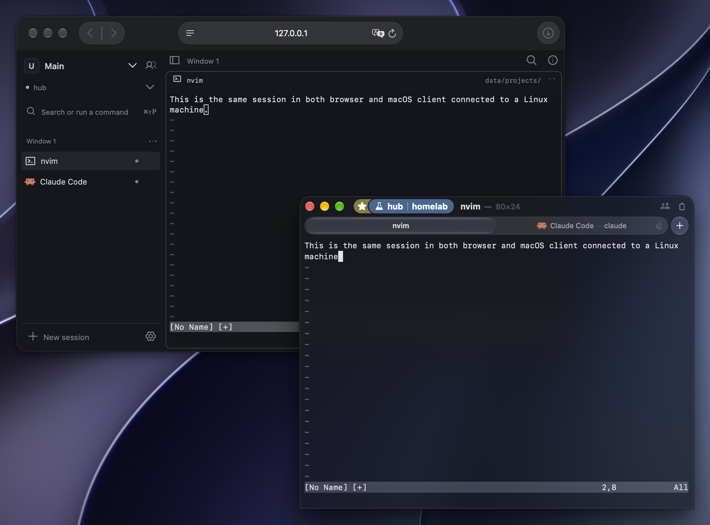

*A fully featured Wasm terminal with multiplexer support: the same Neovim session on a
Linux host, open in the browser and native Mac app at the same time. The host owns the
process and terminal state; each client draws its own view.
[Browser setup and limitations](https://ubiquitty.org/platforms/web/).*

> **The multiplexer and remote sessions are experimental** and still taking shape, while
> the terminal itself is full-featured: it has the highest score in our conformance
> comparison, passing all 4,532 applicable cases. Don't run `ubiquitty-host` on production
> servers or other important infrastructure yet.

[Install](#install) · [Rendering examples](#screenshots) ·
[Conformance](#conformance) · [Parser benchmarks](#benchmarks) ·
[Remote sessions and agents](Docs/guides/remote-sessions-and-agents.md)

| Advantage | What you get |
|---|---|
| **Terminal compatibility** | ECMA-48, DEC and VT behavior, plus modern extensions; every applicable case in our full-suite comparison passes. [Scope](#conformance). |
| **Native rendering** | CoreText shaping, ligatures and color emoji on macOS. The Apple Metal renderer retains unchanged content and repaints changed regions. [Renderer](https://github.com/ubiquitty/kit/blob/main/Docs/swift-renderer.md). |
| **Everyday macOS workflow** | Draggable tabs and split panes, the Beam command palette, prompt navigation, styled copy and clipboard history. |
| **Accessibility** | VoiceOver access to terminal screen text on macOS and a GTK accessible-text interface on Linux. [Guide](Docs/guides/accessibility.md). |
| **Persistent sessions** | Disconnect a client and reconnect to the same host-owned processes, screen and scrollback. |
| **Shared work with agents** | CLI and MCP access to the terminal you can see, with host-enforced consent and permissions. |

**Rendering continues during sustained output.** Bounded input batches and frame
deadlines keep continuous output from indefinitely postponing presentation.
Parser throughput, frame delivery, input latency and energy are evaluated
separately; see [Benchmarks](#benchmarks).

**One terminal session, wherever the work runs.** The portable Core is
both the terminal engine and the multiplexer. Native clients, headless tools and
agents attach to the same authoritative session. Rendering stays local while
the host owns the processes and terminal state. An agent requesting access to
a session you occupy waits for your consent.

Clients exist for macOS, iOS, Linux, WebAssembly, Emacs, Neovim and wscons;
`ubq` provides CLI and MCP access. [Install](#install) distinguishes release
downloads from clients built from source.

| Surface | Interface |
|---|---|
| **macOS app** | AppKit + Metal + Swift; native rendering driven by the shared Core |
| **`ubiquitty-host`** | Headless persistent Core; sessions survive disconnect |
| **`ubq`** | CLI + in-process MCP server for live terminal sessions |
| **Linux frontend** | GTK4 + Vulkan over the same Core; local sessions, no `ubiquitty-host` attach |
| **iOS app** | SwiftUI + Metal thin client; SSH, Keychain credentials, and QUIC |
| **Web frontend** | Core compiled to WebAssembly, WebGL rendering; [browser and native clients sharing one session](https://ubiquitty.org/platforms/web/) |
| **wscons frontend** | OpenBSD/NetBSD console interface without a GUI toolkit or GPU |
| **Emacs client** | Protocol-only client; snapshots, row deltas, and inline images on graphical frames ([reference](Source/Platform/Emacs/README.md)) |
| **Neovim client** | Lua client through the host attach bridge; snapshots and row deltas ([reference](Source/Platform/Neovim/README.md)) |

The portable Core also builds independently as
[`libUbiquittyCore`](https://github.com/ubiquitty/core/blob/main/Docs/libubiquittycore.md).

## Apps, Kit and Core

| You are building | Reach for | Repository |
|---|---|---|
| The Ubiquitty apps themselves | the macOS, iOS, Linux and web frontends | [`ubiquitty`](https://github.com/ubiquitty/ubiquitty) |
| A terminal view to drop into a macOS or iOS app | UbiquittyKit's `TerminalView` or SwiftUI `Terminal` (Metal) | [`ubiquitty-kit`](https://github.com/ubiquitty/kit) |
| A terminal view in a Linux app, or a software-rendered surface | the Vulkan, FreeType and software renderers and the GTK platform layer | [`ubiquitty-kit`](https://github.com/ubiquitty/kit) |
| A renderer drawing into a texture or layer your app owns | UbiquittyRenderKit (Metal) or the Vulkan renderer's exportable frames | [`ubiquitty-kit`](https://github.com/ubiquitty/kit) |
| Your own UI that draws the terminal itself: a GPU UI toolkit, a game engine, or an editor with its own text system | libubiquitty's public C++ umbrella header and render model | [`ubiquitty-core`](https://github.com/ubiquitty/core) |
| The same from C++, linking Core in your own CMake graph | the C++ session facade and Core's headers | [`ubiquitty-core`](https://github.com/ubiquitty/core) |
| Persistent sessions, a session daemon, attach and reattach across machines | the multiplexer: `ubiquitty-host`, Sync, the `ubq` command and the agent | [`ubiquitty-core`](https://github.com/ubiquitty/core) |

Ubiquitty is three repositories. Each depends only on the ones below it:
[`ubiquitty`](https://github.com/ubiquitty/ubiquitty) →
[`ubiquitty-kit`](https://github.com/ubiquitty/kit) →
[`ubiquitty-core`](https://github.com/ubiquitty/core). This is the top one: the apps.
It carries the Kit as the submodule `Libraries/ubiquitty-kit`, and Core comes with
the Kit, as the Kit's own submodule: the one Core this checkout builds is
`Libraries/ubiquitty-kit/Libraries/ubiquitty-core`.

## Install

### Release downloads

Release downloads:

| Download | Platform |
|---|---|
| [`Ubiquitty-<version>.zip`](https://ubiquitty.org/download/macos) | macOS app for Apple silicon, macOS 26 or later. Unzip it and move `Ubiquitty.app` to `/Applications`. It is Developer ID signed and notarized, updates through Sparkle, and bundles the hosts below. |
| `https://ubiquitty.org/download/host/<version>/ubiquitty-host-linux-x86_64`, `…-linux-arm64` | Static `ubiquitty-host` for Linux servers on x86_64 and arm64, needing no libraries. |
| `https://ubiquitty.org/download/host/<version>/ubiquitty-host-macos-arm64` | `ubiquitty-host` for a Mac with Apple silicon used as a server: the app's own signed helper. |
| `https://ubiquitty.org/download/host/<version>/SHA256SUMS` | The three hosts' SHA-256 digests. |
| Linux AppImage: [x86_64](https://ubiquitty.org/download/linux/x86_64.AppImage) · [ARM64](https://ubiquitty.org/download/linux/aarch64.AppImage) | Linux GTK4 frontend for local sessions. It needs glibc 2.38, GCC 13's libstdc++ and GTK 4.16, or newer, and the Vulkan loader; Debian 13 and Fedora 41 carry them. `chmod +x` it and run it; **Check for Updates…** in its context menu patches it in place from a later release. |

Each host is the file that release's app bundles, byte for byte, and
`https://ubiquitty.org/download/host/<os>-<arch>` sends the newest release's.
Tagged releases also carry a servable Web distribution, Emacs and Neovim source
packages, and iOS device/simulator development bundles. The iOS bundles require
your own signing for device installation; TestFlight is a separate channel.
The recursive source archive includes the BSD wscons frontend. There is no
prebuilt BSD or Intel macOS executable.
[Release artifacts and automation](Docs/release-ci.md).

The Mac app supports a Mac with Apple silicon running macOS 26 or later. Using an
earlier version of macOS or an Intel-based Mac? We're looking for contributors to
bring Ubiquitty there; [Contributing](.github/contributing.md) describes how to
start.

### Build from source

[Building](#building) and the [platform build guide](Docs/platform-builds.md)
list each frontend's prerequisites and command. For the macOS app:

```sh
git clone --recurse-submodules https://github.com/ubiquitty/ubiquitty.git
cd ubiquitty
./Scripts/build-macos.sh          # the app, under the build root
./Scripts/install-macos.sh        # a release build, installed into /Applications
```

`--recurse-submodules` checks out the Kit and, inside it, Core. A clone made
without it fetches both with `git submodule update --init --recursive`.

A local macOS build also builds the static Linux hosts it bundles, with
`./Libraries/ubiquitty-kit/Libraries/ubiquitty-core/Scripts/build-host-linux.sh`, which needs Docker (OrbStack or Docker
Desktop). On a Mac without Docker, `./Scripts/build-macos.sh --no-linux-hosts`
or `UBIQUITTY_LINUX_HOSTS=0 ./Scripts/install-macos.sh` builds the app without
them, and Connect then gives manual install instructions for a Linux server.
A source build includes the updater only after `./Scripts/fetch-sparkle.sh`;
see [Application updates](Docs/auto-update.md#build).

### The remote host

A remote session needs `ubiquitty-host` at `~/.ubiquitty/ubiquitty-host` on the
server. When it is missing, **File ▸ Connect…** offers to upload the matching
host bundled in the app, with your approval. When it can't, **Copy Install
Commands** gives the commands that install it by hand: they download the
published host of the app's own version for the server's platform, check it
against that release's `SHA256SUMS`, move it into place and print its version.
[Remote hosts](https://ubiquitty.org/docs/remote-hosts/#installing-the-host-by-hand)
on the website has the same commands for the current release. Nothing is built
or cloned on the server, and a platform without a published host is told so.

[Remote sessions](Docs/guides/remote-sessions-and-agents.md) covers connecting,
updates, and the host's network listener.

## Why It Matters

**The Core is the multiplexer.** `ubiquitty-host` runs the same terminal Core
headlessly, owns the session state, and sends checkpoints and incremental updates
to thin clients. Your
terminal session can live on a server, survive disconnects, and reattach from
another machine without tmux owning the model.

**An agent can drive your real terminal, and you stay in charge of it.**
`ubq` is a thin client of the daemon speaking the same Sync protocol
as the graphical app, exposing `terminal_*` MCP tools to run commands, read the
screen, wait for changes, screenshot, send input, and interrupt. The terminal it
drives is the one you are looking at — not a pipe, not a scrollback dump.

What makes that safe to switch on is that the human's authority is enforced by
the daemon rather than requested from the agent:

- **The consent hold is a server-side invariant.** An agent attaching a session a
  human occupies is held pending that human's answer — decided from the daemon's
  own view of who is attached, never from a capability bit the client's greeting
  declared. A client the daemon does not recognise cannot opt out of being
  asked by leaving its label off.
- **Identity is kernel-verified.** Standing grants key on the peer pid and
  executable the OS reports (`SO_PEERCRED`, `LOCAL_PEERPID`/`proc_pidpath`) or on
  a token digest — never on the self-reported agent name, which the code treats
  as spoofable throughout. A swapped binary does not inherit a grant. The
  boundary is the user account: a process already running as you can start
  the daemon's own tools, so these tiers guard against unrecognised and
  mislabelled programs, not against code that is you.
- **MCP tools cannot approve themselves.** No `terminal_*` schema carries an
  approve argument. Command-input policy uses allow/confirm/deny rules and an
  audit log; `--yes` answers a confirm decision only from a person's terminal.

- [Agent token auth →](https://github.com/ubiquitty/core/blob/main/Docs/agent-token-auth.md)
- [The who axis →](https://github.com/ubiquitty/core/blob/main/Docs/capability-origin.md)

**A running shell can move without dying.** Share This Window hands the live PTY
from the macOS app to `ubiquitty-host`; the app becomes a thin client of the
same shell, agents can attach with consent, and Stop Sharing reclaims the PTY
back into a normal local window. The process keeps running across the handoff.

**Native rendering, down to the details.** On macOS, CoreText shaping and
Metal rendering support ligatures, color emoji, styled underlines, inline images,
and proportional text alongside aligned monospace code. Box drawing uses font
glyphs stretched to the cell; block elements, shades, the geometric Legacy
Computing glyphs and Powerline separators are drawn as geometry, so they meet
without seams.
The Apple renderer reuses unchanged grid pixels, shifts retained content during
scrolling, and composes the cursor separately.
[Renderer architecture](https://github.com/ubiquitty/kit/blob/main/Docs/swift-renderer.md).

Legacy terminal software renders correctly, including double-height text,
national character sets, protected cells and DEC rectangular screen editing.

**Broad escape-sequence coverage.** Beyond truecolor, OSC 8 links, styled
underlines, ligatures, bracketed paste, and mouse modes, Ubiquitty covers the
Kitty keyboard protocol, animated Kitty graphics, Sixel, and OSC 1337 inline images, Tektronix 4014
vectors, tmux Control Mode (`-CC`) in the macOS app, DEC double-width /
double-height lines, UAX #29 grapheme clustering, and the rarer corners of the
DEC and ECMA-48 SGR surface.

- [ECMA-48 conformance audit →](https://github.com/ubiquitty/core/blob/main/Docs/ecma48_conformance.md)
- [Feature test matrix →](https://github.com/ubiquitty/core/blob/main/Docs/feature_test_matrix.md)

Extended DECPS adds eight musical channels, waveform voices, WAV samples,
envelopes, filters, reverb and tracker effects. Programs can use it for
instruments, sequencers and game audio; the Mac app supplies playback.
[Sound protocol](https://ubiquitty.org/features/sound/).

**Host effects have named capabilities.** Anything that can print
bytes can set your title, read your clipboard, move your window, reprogram a
key, or ask the terminal to open a file. Each of those side effects has an entry
in one `Capability` vocabulary (`Libraries/ubiquitty-kit/Libraries/ubiquitty-core/Source/PAL/Capability.h`). Policies are checked
where the effect happens, not where the sequence parses. The verdict keys on **who
drove it** — `Local`, `Agent`, or `Remote` — so a local program's OSC 52 read
follows `[security] clipboard_read` (a prompt by default), an attached agent's
waits for the person's consent, and a remote peer's is denied. Grants are keyed
per principal and revocable, and Core, the daemon, and the agent MCP surface
share the one enum, so the allow-lists cannot drift apart.

**Permission policy depends on the surface.** The macOS app and host daemon
provide consent-aware policies. Linux, Web, and Wscons also install policies;
their simpler policies keep benign replies and grid effects while refusing
host-escaping and exfiltrating effects for agent or remote origins. They do not
provide the same consent UI as macOS. Origin attribution
and policy installation are both required for this distinction to hold.

With no policy installed, Core answers from PAL's default decisions: local
output runs every effect except the authoritative file reads, which refuse, and
agent or remote output keeps only its benign, informational and rendering
effects, with a consent prompt counted as a refusal. C++ embedding session
factories require an explicit `Session::EffectPolicy` choice: supply a policy
and principal with `EffectPolicy::withPolicy(policy, origin)`, or explicitly
select the existing Local defaults with `EffectPolicy::localDefaults()`.
`RestrictiveCapabilityPolicy` permits grid metadata, rendering and benign
replies while refusing host-escaping and exfiltrating effects for every origin.
The raw model still allows construction without a policy; install one before
feeding untrusted output. The
[embedding guide](https://github.com/ubiquitty/core/blob/main/Docs/libubiquittycore.md#capability-policy)
covers selection and lifetime.
Consent grants access to a session; it does not serialize typing between clients
or isolate commands in an operating-system sandbox.

- [The who axis →](https://github.com/ubiquitty/core/blob/main/Docs/capability-origin.md)
- [The host policy →](https://github.com/ubiquitty/core/blob/main/Docs/capability-host-policy.md)

The capability model distinguishes exfiltration from observation. `DECRQCRA`
can checksum cells a viewer never saw and
the title string carries cwd, command, and `user@host`, so both sit in the
exfil tier; feature and cursor reports do not, because programs block on them
for capability detection and a blanket denial would hang a full-screen app on a
viewed session. On top of the vocabulary, agent commands run through
allow/confirm/deny rules with an audit log before bytes reach the PTY, and
`[security] osc_allow` / `dcs_allow` / `apc_allow` allowlist whole OSC, DCS and
APC classes (`apc_deny = "G"` turns kitty graphics off).

**Clipboard and copy.** Ubiquitty keeps real
OSC 52 buffers for clipboard / primary / secondary / select / cut 0–7, writes
styled RTF + HTML on normal copy, can copy without background colour, can copy
styles only with no colours, can render copied text through any built-in theme,
and can shell-escape either the clipboard or the current selection before
pasting.

## Conformance

**Full-suite result: 4,532 / 4,532 applicable cases passed (100%).**

The next-best tested engine in our [recorded comparison](https://github.com/ubiquitty/core#correctness-and-performance),
Ghostty's `libghostty-vt` main (`cf3a8a659`), passed **3,004 / 4,532 cases (66.3%)** in our tests on
**12 November 2026**.

The comparison checks terminal behavior against ECMA-48, DEC STD 070, the VT
manuals, and the originating specifications for extensions. Documented xterm
behavior can be an accepted alternative. Where a standard leaves a choice,
each outcome it permits is accepted; where two DEC documents disagree, either
is accepted; and where two specifications define one sequence, as kitty's color
protocol and the VT520's DECSWT both define OSC 21, each one's behavior is
accepted.

We publish aggregate results and the scoring policy here. The complete
comparison corpus and the per-terminal failure matrix will be published later.

Conformance tests check screens, cursor state, attributes and replies. Every
engine in the full-suite comparison runs the same cases; a full pass requires
every check to pass against an accepted expectation. Partial checks and errors
do not count as full passes. Host-dependent cases leave every engine's total.

A pass meets the standard's expectation or an accepted alternative. The result
describes the applicable cases in this suite. A DECRQM capability-query case
can pass by correctly reporting an unsupported mode; that query pass does not
claim implementation of the mode itself.

Greek and secondary keyboard selection, page-to-screen auto-sizing, CRT overscan,
modem control, connection-triggered answerback and serial half-duplex are
unsupported. DECRQM reports them as unrecognized. Transmit rate limiting is
permanently reset.

[Conformance decisions](https://github.com/ubiquitty/core/blob/main/Docs/conformance.md) link each behavior to its authority
and Core regression tests.

## Benchmarks

**Ubiquitty was the fastest parser among the engines and workloads in our
comparative runs.** This is a parser-throughput result; interactive latency,
native rendering and energy are separate measurements.

Throughput comparisons use [ubench](https://github.com/ubiquitty/ubench),
[`kitten __benchmark__`](https://sw.kovidgoyal.net/kitty/performance/)
and [vtebench](https://github.com/alacritty/vtebench).

The repository includes portable performance tests and regression tooling.
Measure parser throughput, input latency, rendering, and energy separately;
one number does not establish all four. Run measurements on a quiet machine
with recorded hardware, versions, geometry, fonts, and workload.

[The performance guide](https://github.com/ubiquitty/core/blob/main/Docs/benchmarks.md) covers the tools and measurement
methods.

## Session synchronization

The [synchronization specification](https://github.com/ubiquitty/core/blob/main/Docs/sync.md) defines how clients share
authoritative host state. A checkpoint establishes terminal state; incremental
updates carry changed rows, dictionaries, and state blocks. A client verifies
the state digest before accepting an update. History travels in bounded ranges
instead of being bundled into each screen update.

Input is sequenced and acknowledged at the PTY-write boundary. A receipt does
not mean that an application has completed a command. Reconnection uses retained
state when it matches; otherwise the host supplies a checkpoint. The protocol
also defines workspace topology, permissions, graphics transfers, cache
validation, and host handover.

Scrollback storage uses lossless text-and-style-run compression for older
blocks, with a small decode cache. Maintenance runs after I/O and frame
delivery, rotating among quiet sessions under a bounded work budget. Storage
compression does not change history identities or the wire format.

## Screenshots

### Terminal rendering

The terminal-rendering examples below use Noir.

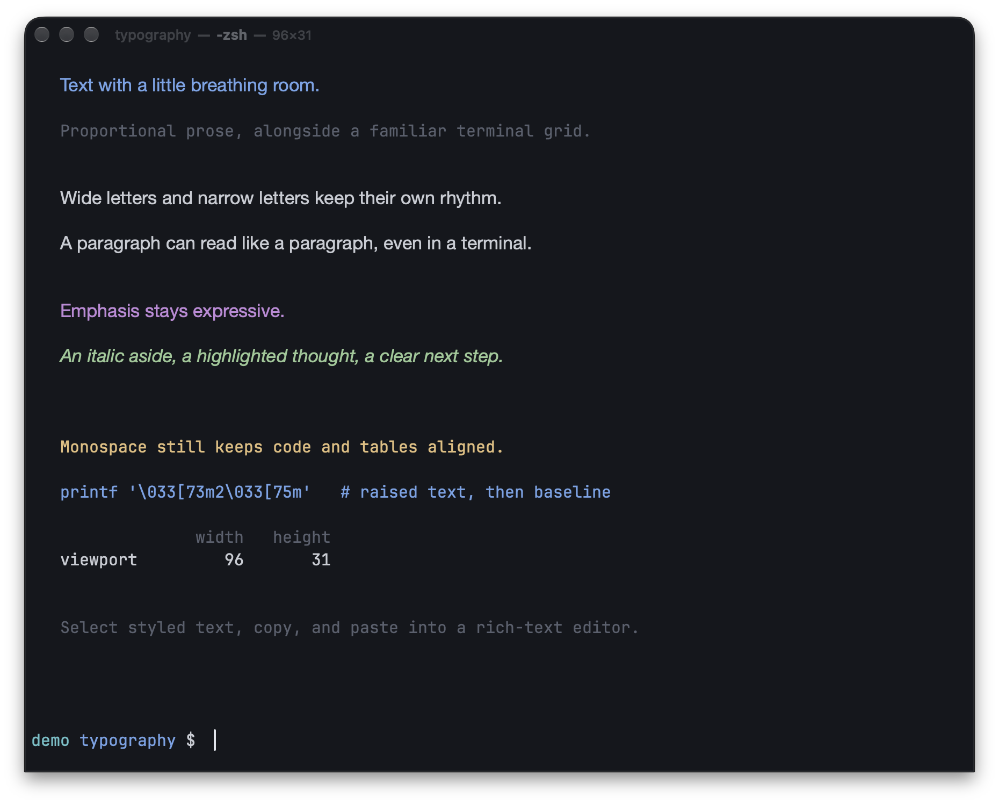

*Proportional text runs alongside monospace code and tables in a local session.*

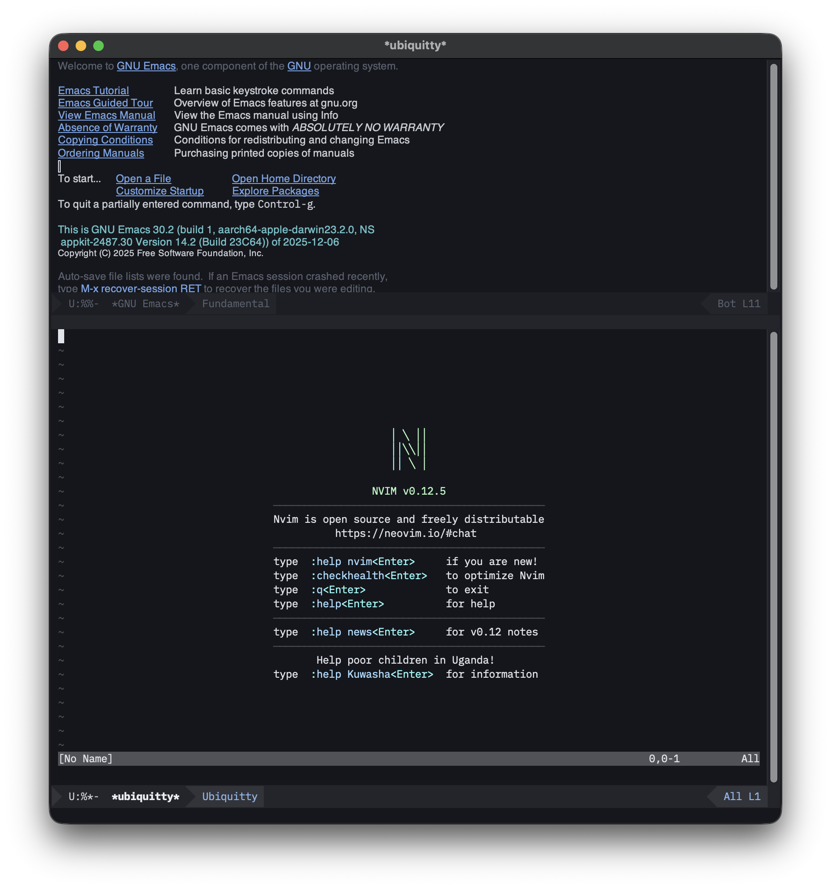

*Neovim running inside Ubiquitty inside Emacs GUI.*

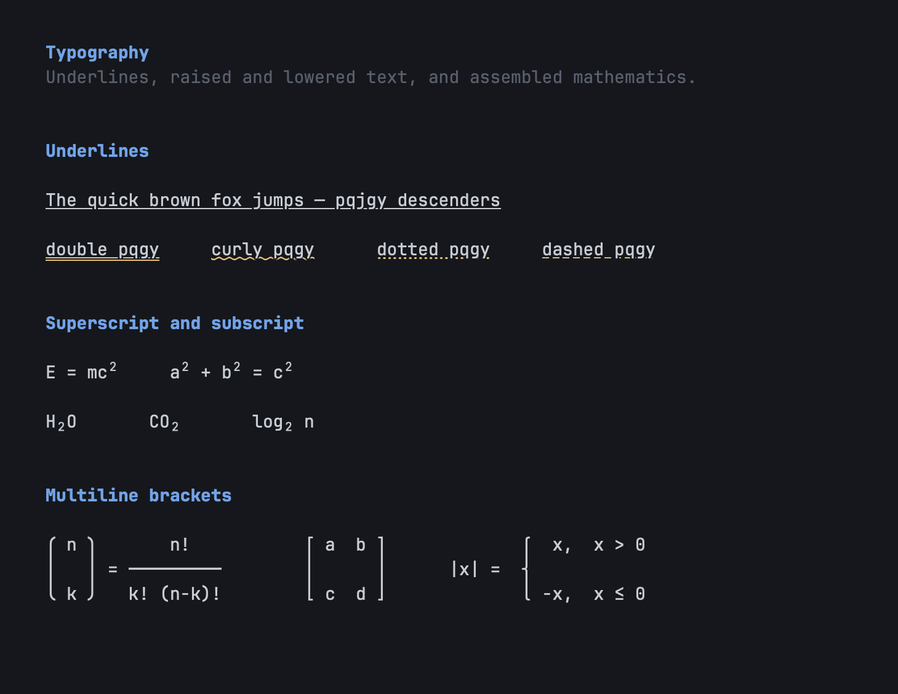

*Rendering examples from the polish demo: underline styles and skip-ink,
SGR superscripts/subscripts, and mathematical brackets assembled across rows.*

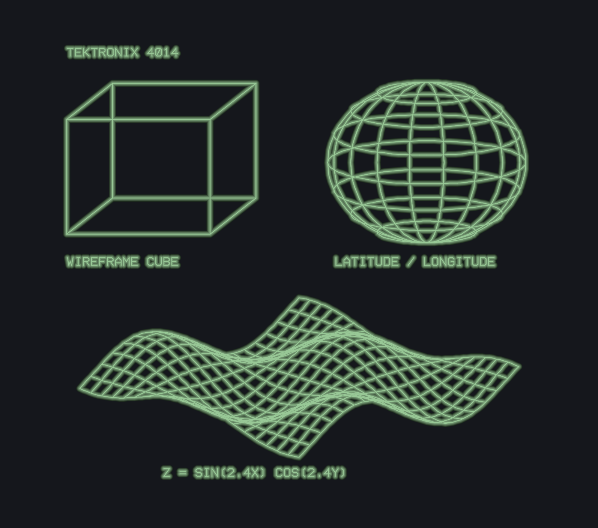

*Tektronix 4014 vector graphics and alpha text: a labeled cube, a
latitude/longitude globe, and a sine-wave mesh, with mint-green phosphor and a
soft, compact halo on a dark storage-tube background. The labels are drawn by
the terminal too.*

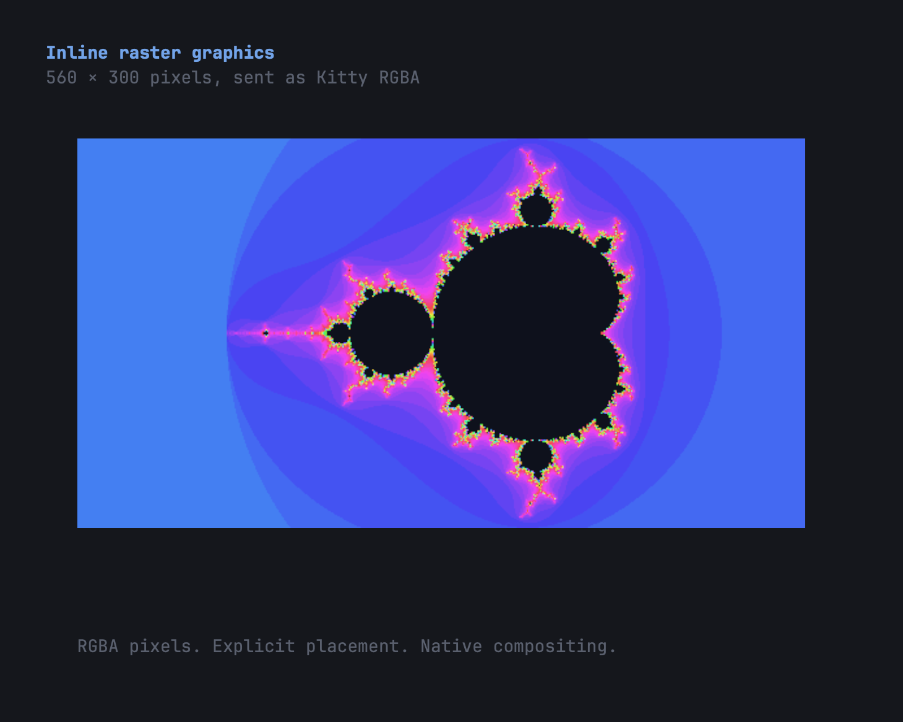

*Inline raster graphics: a 560×300 Mandelbrot image transmitted with the Kitty
graphics protocol (`a=T,f=32` RGBA, scaled to 70 columns) and composited into
the grid. Sixel and iTerm2 inline images render through the same path.*

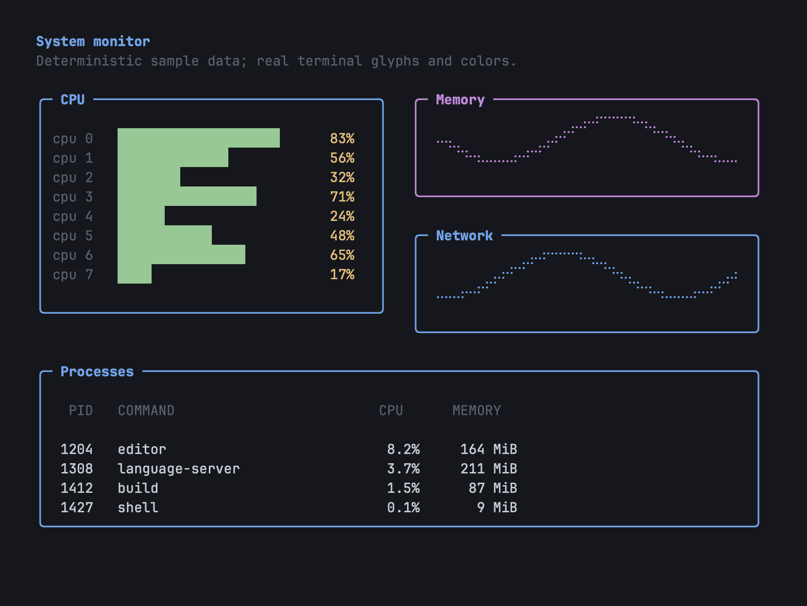

*An illustrative TUI dashboard: rounded box-drawing panels, truecolor per-core
CPU bars (with sub-cell partial blocks), braille line graphs for memory and
network history, and a process table — box-drawing, 24-bit color, and Unicode
together.*

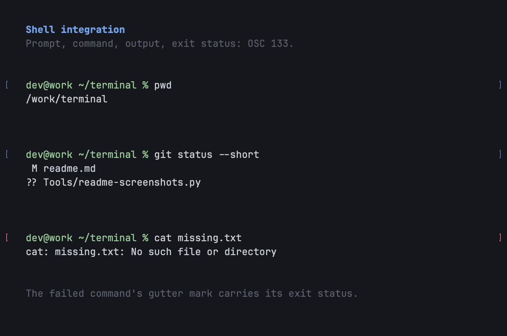

*OSC 133 shell-integration marks: each executed command gets a prompt bracket
in both gutters, with a different color for a non-zero exit — the anchors
for jump-to-prompt and clear-to-mark.*

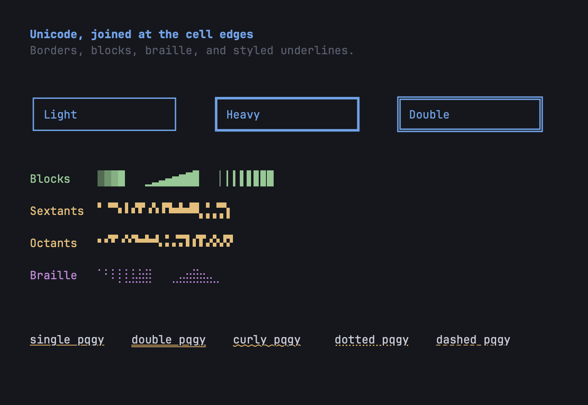

*Box-drawing in three weights, shade ramps and half-blocks, Legacy-Computing
sextants/octants, braille, and single, double, curly, dotted, dashed, and
colored underlines.*

## How it started

On 8 May 2026 I wanted a VT100 terminal for Mac OS 9. It was called MacTerm, it ran on my PowerBook G3
"Pismo" (and in SheepShaver, for testing), and nine days later it was showing Claude Code: the mascot, the model line
and a story about a fox, on a Platinum desktop.

<a href="Docs/images/macterm-2026-05-17.png">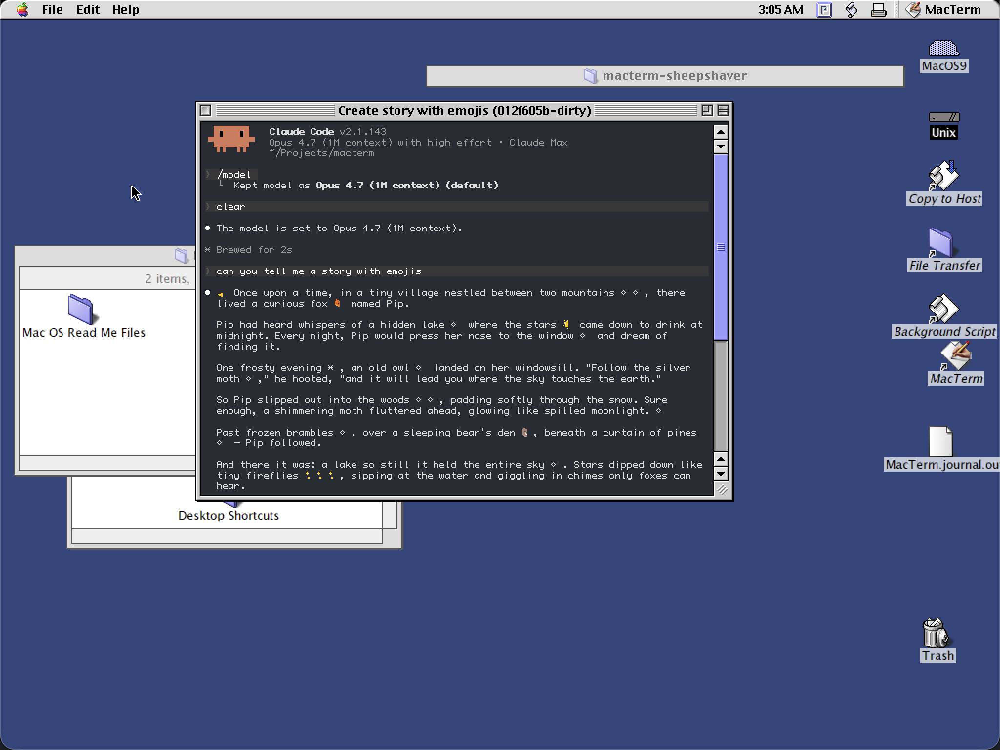</a>

*MacTerm on 17 May 2026, nine days after the first commit. That is Claude Code in 1999's idea of a window: this capture is SheepShaver, the
real thing was the Pismo.*

Then I wanted an automated harness on my macOS: something that could drive the terminal, look at the screen
and say whether it was right, without me squinting at it. The harness needed a terminal it could trust, and the
terminal needed to be testable from the outside, so the two grew together.

And then, in the end, I decided: why not make the most portable, most compliant and fastest terminal emulator
there is, with the multiplexer built in? One Core does the emulating, and a frontend only has to draw cells and
send keys. So a frontend can run on nearly anything: a programmable kettle (if such things exist), a
[pregnancy test](https://www.popularmechanics.com/science/a33957256/this-programmer-figured-out-how-to-play-doom-on-a-pregnancy-test/),
or your favourite Texas Instruments calculator. Those three are next. These already run:

### A DEC VT520 from 1994

A VT520 is a 1994 terminal. It has never heard of UTF-8, colour or Claude Code. Here is what happens when you
point modern programs straight at it, and what happens when Ubiquitty stands in between.

| What Claude Code looks like to a VT520 on its own | ...and through Ubiquitty |
| --- | --- |
| <a href="Docs/images/vt520-claude-code-plain.png">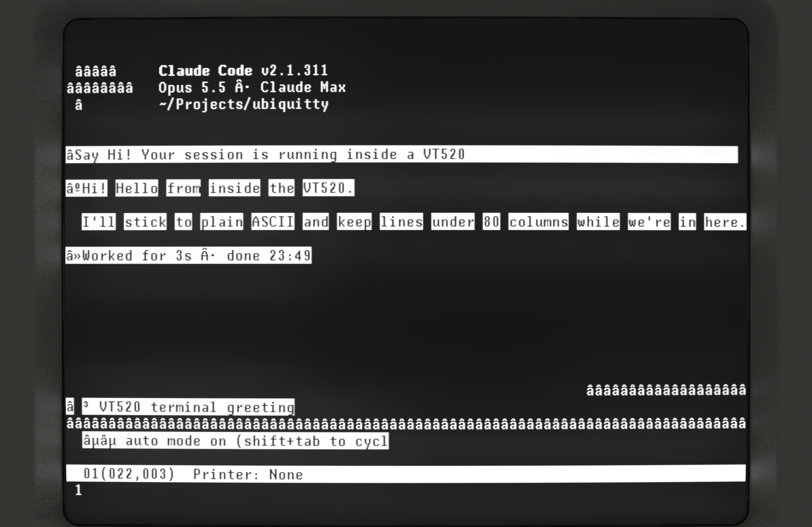</a> | <a href="Docs/images/vt520-claude-code.png">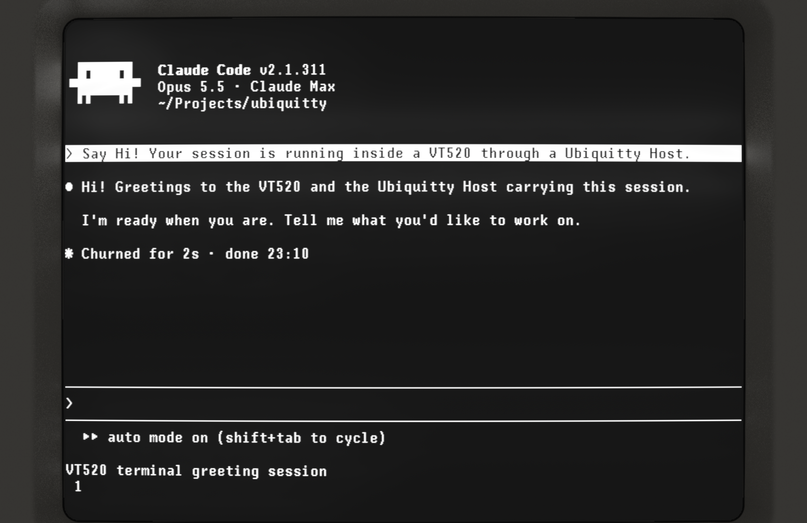</a> |

| Neovim, same VT520, no help | ...and through Ubiquitty |
| --- | --- |
| <a href="Docs/images/vt520-neovim-plain.png">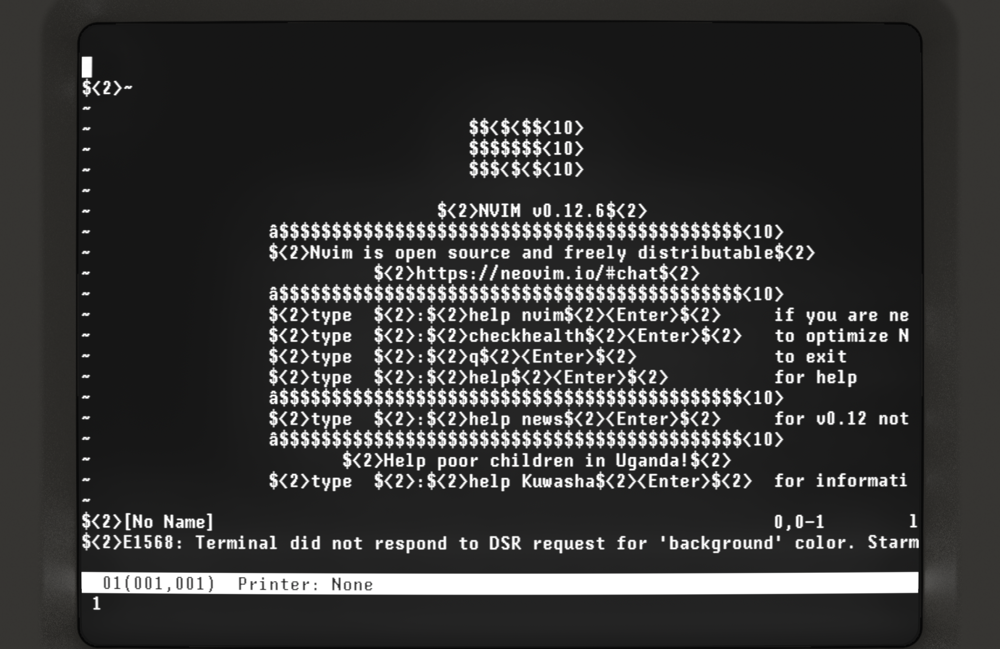</a> | <a href="Docs/images/vt520-neovim.png">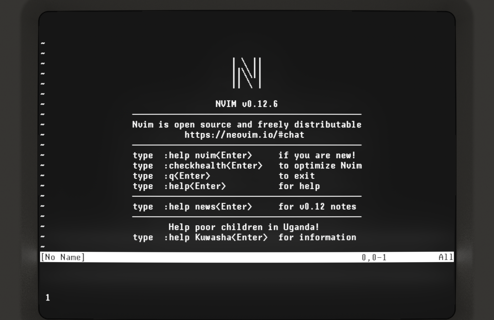</a> |

*Yes, `$<2>` is the terminal being sent its own padding instructions as text.*

Ubiquitty's Core does the emulating, and `ubiquitty-vt520` translates the finished screen into what the
terminal understands:

- **Line drawing** uses DEC Special Graphics, a character set older than most of the people reading this.
- **Blocks and symbols** (the mascot, `⏺`, `✻`, `⎿`, `…`, rounded corners, Neovim's diagonals) are drawn as
  DECDLD soft-font glyphs, sized to the terminal's cell.
- **Accents** come from ISO Latin-1 through single shifts. No soft font needed.
- **Colour** becomes bold, underline, blink and reverse. A highlighted row such as Claude Code's message box
  is reversed as one bar.
- **Titles and tabs** live in the host-writable status line, as they should.
- **The screen size** is read from the terminal's own Set-Up (80 or 132 columns, 24 to 53 lines) and
  followed when it changes. The client never sets it.

It is a proof of concept. The client embeds Core and runs local PTY tabs; it does not attach to a
`ubiquitty-host` session. It has been run against the simulator, not real hardware, and it has no mouse,
wide characters or heavy and double box lines. It lives in its own repository; see
[its README](https://github.com/yaglo/ubiquitty-vt520/blob/main/README.md) for how to run it and its limits.

### MS-DOS

Claude Code, on MS-DOS. It is exactly as silly as it sounds and exactly as real: a 16-bit `UBQ.EXE` owns the
PC's VGA text screen, the session runs on a modern machine, and Core in the middle turns one into the other
over COM1.

| Claude Code | Midnight Commander |
| --- | --- |
| <a href="Docs/images/dos-claude-80x25.png">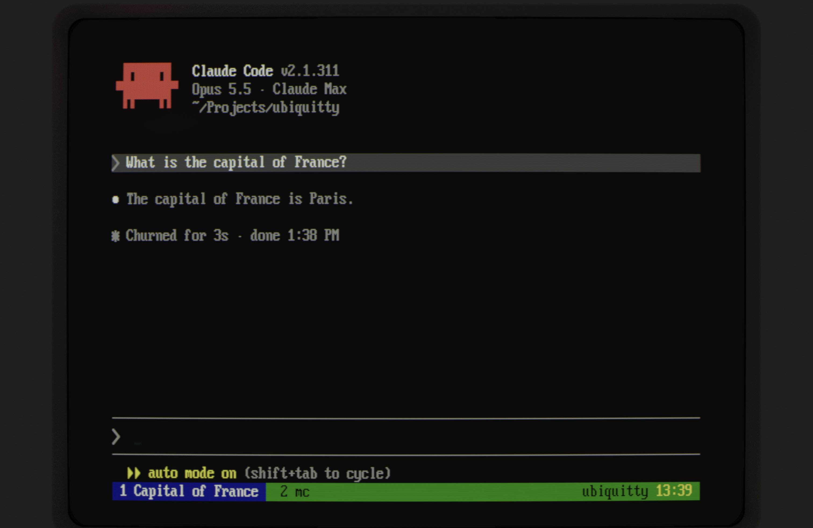</a> | <a href="Docs/images/dos-mc-80x25.png">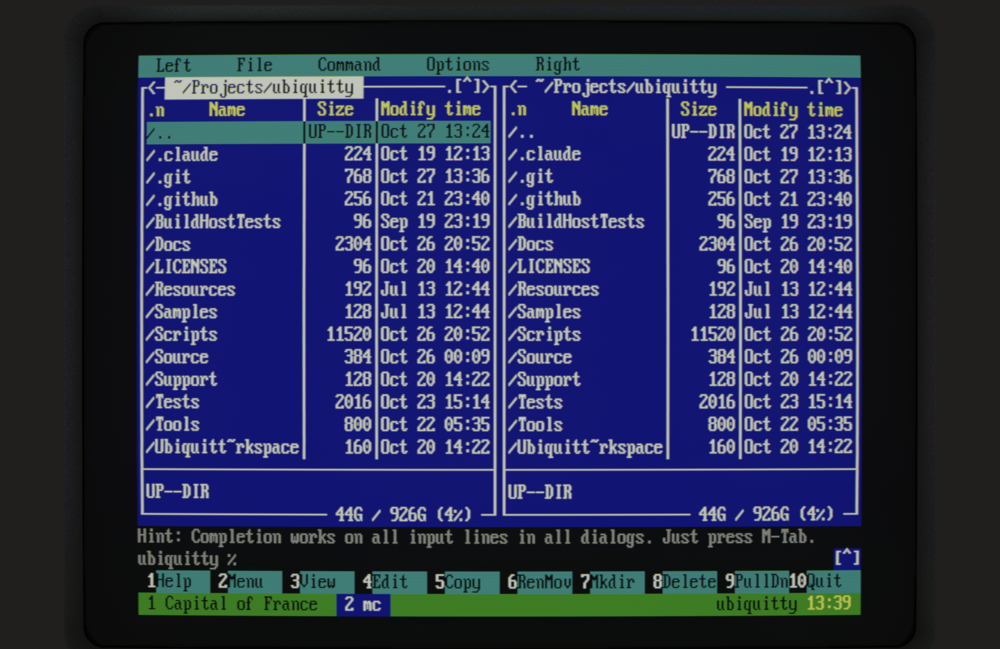</a> |

*Live sessions (`claude --model opus`, then `mc` in a second tab) in DOSBox-X at 80x25, on an emulated IBM 8513
colour monitor through MyCRT ([the setup](https://github.com/yaglo/ubiquitty-dos-mycrt)): CP437 and 16 colours. The mascot, bullets and chevron are glyphs loaded into the VGA
font; the bottom row is the tab bar. Midnight Commander looks the way a DOS file manager is supposed to, because
on this screen it is one.*

- **Characters** are CP437, the PC's own set. Box drawing and shades come from the ROM font.
- **Symbols it lacks** (the mascot, `⏺`, `❯`, `✳`, rounded corners) are drawn into spare VGA font slots, 16 at a time.
- **Colour** is the 16 VGA colours, chosen by perceived distance. Claude orange becomes CGA brown, which is
  historically accurate if not flattering.
- **Text modes** go from 80x25 up to 132x60, whichever the card offers.
- **The line** is a CRC-checked framed protocol that survives a noisy serial cable, and paces itself to 9600 baud if asked.

It is a proof of concept, tested in DOSBox-X rather than on a real PC. See
[Ubiquitty for DOS](https://github.com/yaglo/ubiquitty-dos), its own repository.

### Mac OS 9, again

MacTerm's Classic frontend left the repository on 2 June 2026, when Core moved to C++23 and
Retro68 couldn't follow. It is back as a thin client. All the terminal processing happens on the host:
`ubiquitty-classic-host` runs the programs and Ubiquitty's Core, which parses their output and keeps the screen.
The old machine only gets the finished screen, as characters and attributes, and draws it with QuickDraw; a small
PowerPC program in [Ubiquitty Classic](https://github.com/yaglo/ubiquitty-classic), its own repository, does that and sends the keys back.

<a href="Docs/images/macos9-claude-code.png">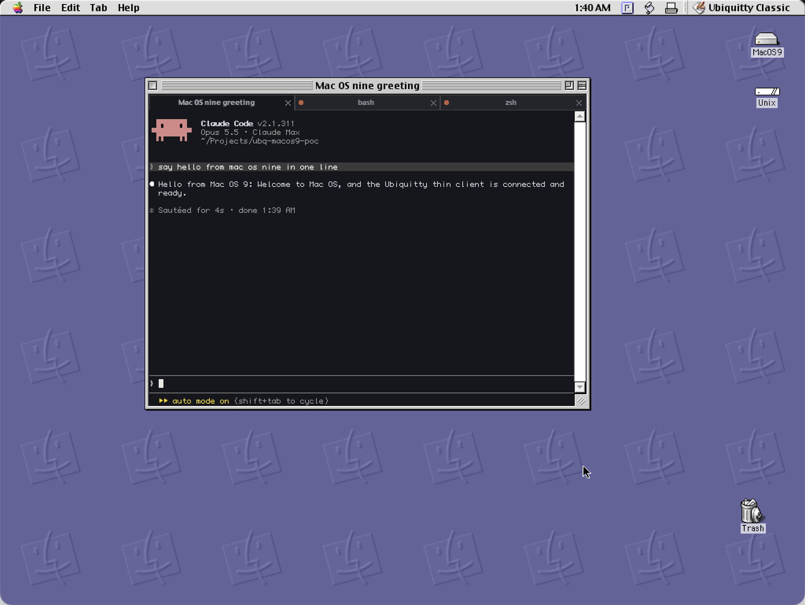</a>

*Ubiquitty Classic in SheepShaver, attached to a live `ubiquitty-classic-host`: Claude Code on Opus in the first of three tabs in
MacTerm's tab strip, in Noir and Monaco 9. The window, menu bar and desktop are Mac OS 9's own.*

| Neovim | A shell with characters Mac OS 9 has no font for |
| --- | --- |
| <a href="Docs/images/macos9-neovim.png">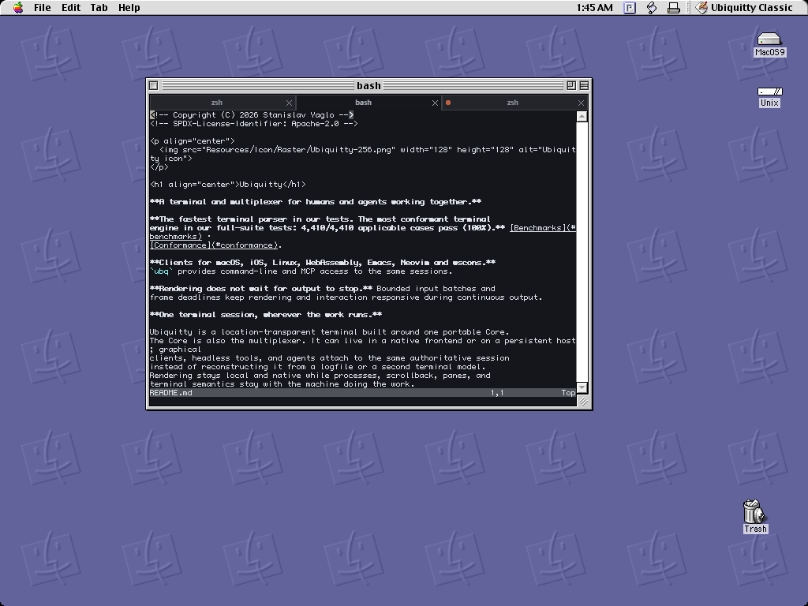</a> | <a href="Docs/images/macos9-emoji.png">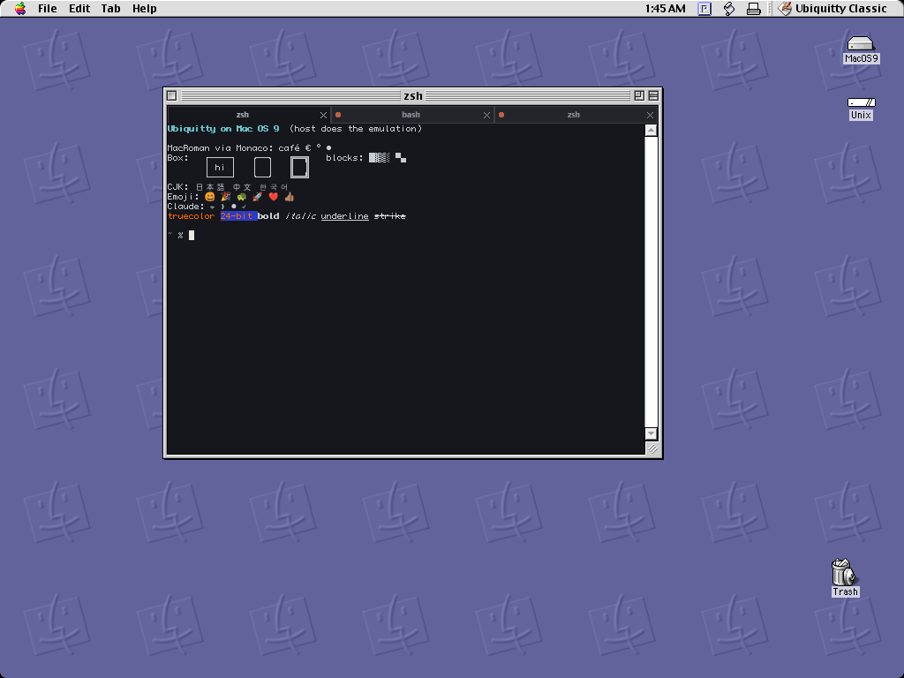</a> |

Mac OS 9 has no Unicode fonts, so the host decides how each glyph is drawn. Characters in MacRoman go as
bytes and draw in Monaco; everything else is rasterised on the host at the client's cell size and sent
once as a small bitmap the client caches by id. Colour emoji go as RGBA. Only the cells that changed are sent,
and keys come back as Mac virtual key codes, which the host maps to what the session expects. See
[the host](https://github.com/yaglo/ubiquitty-classic/blob/main/Source/Platform/ClassicHost/README.md) and [the client](https://github.com/yaglo/ubiquitty-classic/blob/main/Clients/MacOS9/README.md).

## What's in the box

**Terminal engine** (portable Core, shared by every frontend)

- [Conformance](#conformance): full-suite coverage of standard control-sequence
  behavior and extensions. [Conformance decisions](https://github.com/ubiquitty/core/blob/main/Docs/conformance.md) document
  the authorities and Core regression tests.
- Hand-written Williams-style DEC/ANSI parser DFA — C0 and C1 controls, OSC,
  DCS, APC, PM, SOS. Identifies as a VT525-level terminal and implements the
  VT500 functions that level names.
- DEC features: DECCOLM (132 columns compressed in place, or a window resize),
  DECDWL / DECDHL, DECSTBM and DECSLRM margins, rectangular area ops and
  selective erase, DECDLD soft fonts, NRCS and 96-character sets, the status
  line, the printer controller, DECUDK, the DEC locator, DECRLM, DECHEM, CRT
  saving, a concealable answerback, DECSCUSR cursor shapes, DECAC and DECATC
  colour assignments, alternate screen.
- ECMA-48 functions xterm does not implement: line tabulation (VTS, CVT, CTC),
  TSR, fields (HTJ, EF), aligned tabs, SLH and SLL, SIMD, QUAD's flush and
  centre, SPD's position update, guarded areas (DAQ) with EA and ERM, GRCM and
  CCH.
- Reports: DA1 / DA2 / DA3, DSR / CPR, DECRQM, DECRQSS, DECRQCRA, DECCIR and
  DECTABSR (restored by DECRSPS), XTGETTCAP, XTGETXRES, XTVERSION.
- Modern extensions: 24-bit truecolor, bracketed paste, focus events,
  synchronized output (DECSET 2026), color-scheme notification (DECSET 2031),
  mouse modes (X10 / VT200 / SGR / SGR-pixel / urxvt), the kitty keyboard
  protocol, modifyOtherKeys and DECKPM key-position reports.
- Colon-SGR with styled and colored underlines (double / curly / dotted /
  dashed, 58/59), overline, framed/encircled, superscript/subscript; OSC 4 /
  10–19 dynamic colors, OSC 21 kitty color control, a ten-slot color stack;
  built-in palette themes with system dark/light auto-switch.
- [Kitty graphics protocol](https://sw.kovidgoyal.net/kitty/graphics-protocol/)
  (PNG, zlib, animation frames), Sixel, and
  [OSC 1337](https://iterm2.com/documentation-escape-codes.html) inline images —
  decoded in the Core and painted by image-capable renderers. The Neovim client
  does not show inline images.
- Tektronix 4010/4014 vector mode: GIN crosshair reports and frames shown
  whole, with opt-in bright-pen and additive "glowing vectors" effects.
- UTF-8 with Unicode 17.0 UAX #29 grapheme clustering — ZWJ emoji families,
  skin-tone / flag / VS16 sequences, and combining-mark stacks shape as single
  cells. Legacy encodings include ISO 8859, KOI8-R, Shift_JIS, EUC, GB18030
  and Big5.

**Modern OSC protocols**

- Hyperlinks: [OSC 8](https://gist.github.com/egmontkob/eb114294efbcd5adb1944c9f3cb5feda)
  attaches URLs to text.
- Shell integration: [OSC 7 and 133](https://iterm2.com/documentation-escape-codes.html)
  report working directories, prompt, input and output sections, and exit
  status. [OSC 633](https://code.visualstudio.com/docs/terminal/shell-integration#_supported-escape-sequences)
  sequences also supply command-line and directory metadata.
- Clipboard: [OSC 52](https://invisible-island.net/xterm/ctlseqs/ctlseqs.html)
  transfers text; [OSC 5522](https://sw.kovidgoyal.net/kitty/clipboard/)
  transfers MIME-typed data, including images and rich text, and can announce
  a paste by its MIME types.
- Drag and drop: [OSC 72](https://sw.kovidgoyal.net/kitty/dnd-protocol/)
  receives drops and sends drag offers, including files and directory trees.
  Reads require a native drop; offers require a native gesture.
- Text sizing: [OSC 66](https://sw.kovidgoyal.net/kitty/text-sizing-protocol/)
  supports scaled text and explicit cell widths. Ubiquitty also provides
  [proportional text runs](https://github.com/ubiquitty/core/blob/main/Docs/proportional-text.md) and
  [rich text blocks](https://github.com/ubiquitty/core/blob/main/Docs/rich-text.md).
- Kitty color control: [OSC 21](https://sw.kovidgoyal.net/kitty/color-stack/)
  sets and queries palette, default, cursor and selection colors; OSC 30001 /
  30101 save and restore them.
- Mouse pointer shapes: [OSC 22](https://sw.kovidgoyal.net/kitty/pointer-shapes/)
  sets, pushes, pops, and queries pointer shapes.
- Progress: [OSC 9;4](https://conemu.github.io/en/AnsiEscapeCodes.html)
  reports determinate, indeterminate, paused, and error states; VTE's OSC 666
  progress properties are also supported.
- Desktop notifications: [OSC 9](https://iterm2.com/documentation-escape-codes.html),
  [OSC 99](https://sw.kovidgoyal.net/kitty/desktop-notifications/) and urxvt's
  OSC 777, including chunked title/body messages, display occasions and
  support queries. OSC 99 icons, buttons, close requests and activation
  reports are not implemented; [notification details](https://github.com/ubiquitty/core/blob/main/Docs/tab-status.md).
- iTerm2 extensions: [OSC 1337](https://iterm2.com/documentation-escape-codes.html)
  supports [inline images](https://iterm2.com/documentation-images.html),
  selected commands for marks, working directory, remote host, user variables
  and badges, and answers cell-size and variable queries.
- Execution contexts: [OSC 3008 / UAPI.15](https://uapi-group.org/specifications/specs/osc_context/)
  retains hierarchical shell, command, remote, and container metadata.
- Program activity: [OSC 7501](https://www.superlogical.com/rex/docs/build/program-status)
  reports job state, progress, and blocked reasons;
  [OSC 21337](https://iterm2.com/documentation-escape-codes.html)
  sets a tab's status label and colored indicator.

Rendering, available clipboard MIME types, and desktop integration depend on
the frontend. Clipboard access, drag and drop, and notifications are
permission-controlled.

**Native macOS app**

- Metal renderer shared with the iOS app: CoreText rasterisation into a glyph
  atlas, ligature shaping, and a separate sheet for colour emoji. Box drawing
  uses the font's glyphs, centred and edge-stretched to the cell. Shades, block
  elements, Legacy Computing sextants and octants, diagonals and Powerline
  separators are drawn as geometry, so they meet without seams. Output is in
  sRGB or Display P3 (the default).
- Fonts: family, size, ligatures, OpenType features and stylistic sets,
  per-script and CJK font routing, line and character spacing, and underline
  tuning. Themes follow the system's light/dark appearance, can be edited and
  exported, and iTerm2 and Ghostty themes can be imported.
- Window: background opacity with blur and vibrancy, a background image (fill /
  fit / stretch / tile / center, with its own opacity), a Liquid Glass tab
  strip, a hidden title bar, Keep on Top, and a drop-down terminal on a global
  hotkey.
- Tabs and split panes: native macOS tabs, splits right and down, pane zoom,
  directional focus and pane title bars. A tab or pane can be dragged into any
  split of another tab, a new tab or a new window; its session keeps running.
  Broadcast Input sends typing and pastes to every pane in the window and shows
  a pill while on. Reopen Closed Window (⌘⇧T) brings back a single-tab local
  window closed without a confirmation in the last 30 seconds, with its
  processes still running.
- A background tab shows one mark, in order of rank: an OSC 9;4 progress ring,
  an unheard bell, the program's status dot (OSC 7501 state with its own symbol
  and colour, or the OSC 21337 colour), a notification dot, or unread output.
  Holding ⌘ shows its number.
- Title row: the title is built from parts you choose (directory, the
  program's title, the process chain, size, program status). Window tags
  (`[[tags]]` rules matched by host or profile, or applied by hand) appear in
  the order the rules are listed, as labelled capsules, icons or coloured dots,
  in the title bar, on tabs and in pane headers, each rule choosing where; they
  can tint the title bar. A host chip
  names a remote host and shows the link's health. Other clients attached to
  the session are shown.
- **Beam** (⌘⇧P): a native command palette for commands and settings,
  fuzzy-ranked, with settings edited inline. Prefixes select a **scope**:
  `@` jumps to a command block (OSC 133), `/` searches scrollback, `:` goes to a
  tab or pane, `#` lists settings. ([reference](Docs/beam.md))
- Shell integration in the UI: prompt brackets that turn red on a non-zero
  exit, jump between prompts, Select Last Command Output and Clear to Previous
  Mark. Links open with ⌘-click, and a preview shows the real target of an
  OSC 8 link. OSC 22 pointer shapes become native cursors. A lock badge marks
  password prompts. Triggers highlight matches, notify or run a command, and
  macros send named input.
- Inspector (⌘I): the session's process tree and foreground chain, with
  signals, plus title, geometry and appearance controls.
- Multi-buffer clipboard: OSC 52's selections (clipboard / primary / secondary
  / select / cut 0–7) each get an app-wide buffer, plus a ring of recent copies,
  all pasteable from the ⌘⇧V panel. OSC 52 reads prompt by default.
- Copy writes RTF and HTML alongside plain text. Copy Special adds Copy Without
  Background Color (⌃⇧⌘C), Copy with Styles Only, Copy Plain Text (⌥⇧⌘C) and
  Style for Copy, which renders the copy in any theme. Paste Escaped Text (⌃⌘V)
  and Paste Escaped Selection (⌃⇧⌘V) paste shell-escaped text.
- Find bar with case and regex options, rectangular selection, tmux control
  mode (`tmux -CC`) panes as native splits, session logging to a file, OS
  notifications, VoiceOver access to the screen text, a `[keys]` binding
  engine, AppleScript `do script`, Sparkle updates, and Secure Keyboard Entry
  (on by default).

**`ubiquitty-host` daemon + `ubq` client**

- `ubiquitty-host` runs the portable Core as a persistent server: Core, the
  Sync protocol, a POSIX PTY and sockets, with no Cocoa, Metal or Swift. It
  builds on macOS and Linux. The macOS and iOS apps, the Emacs and Neovim
  clients (through `ubiquitty-host --attach`), the Web client (through a
  WebSocket bridge, `Scripts/web-proxy.py`) and `ubq` attach to the same
  sessions. The VT520 client, and the modern-machine halves of the MS-DOS and
  Mac OS 9 clients (`ubiquitty-dos`, `ubiquitty-classic-host`), embed Core and
  run local PTY tabs; none attaches to `ubiquitty-host`.
- Sessions survive disconnects. Remote macOS and iOS windows sign in through
  SSH and use a QUIC data plane when UDP gets through, falling back to SSH when
  it does not. A reconnect resumes from retained state or a fresh checkpoint.
  History travels as logical lines, and a client wraps them to its own width.
- Workspaces outlive the clients that open them, named or unnamed. The host
  records each one's windows, tabs, splits, directories and grids. After the
  host restarts it lists the workspace as restorable, and restoring it starts a
  fresh shell in each recorded directory. The Web client's "Keep unnamed
  workspaces on this host" is on by default; turning it off makes new unnamed
  workspaces end on detach.
- A new daemon started on the same machine can take over the running one's
  panes: each PTY, checkpoint, history and the resume table. The sessions keep
  running (Linux needs `SO_PEERPIDFD`, Linux 6.5). Connect's remote Update
  either waits until the sessions end or ends them.
- Share This Window with Agents moves every running shell in a macOS window,
  tabs and splits included, into a new or existing host workspace. Stop Sharing
  returns them to the window. The processes keep running.
- `ubq` is a headless Sync client for people, scripts and AI agents. Its verbs
  (ls / tree / new / run / send / read / search / split / kill / label / tag /
  status / wait / events / api) and the `terminal_*` tools of its MCP server
  (`ubq mcp`, JSON-RPC over stdio) come from one method registry.
  `-H [user@]host` drives a daemon on another machine over ssh. The manual is
  [Docs/ubq.md](https://github.com/ubiquitty/core/blob/main/Docs/ubq.md).
- The daemon enforces agent access. Agents need a capability token by default;
  tokens are scoped and can expire or be revoked. An agent attaching to a
  session a person occupies waits for that person's consent. Commands pass an
  allow/confirm/deny policy with an audit log, and each workspace tree edit
  needs a person's approval. On macOS a presence pill shows attached agents,
  and the Session menu revokes each one.
- The macOS host management window lists a host's sessions, clients, grants
  and tokens. It can terminate a session, disconnect a client, revoke a grant,
  issue or revoke a token, and copy a session handoff link or show it as a QR
  code.
- `terminal_screenshot` renders the synced grid and its images to a PNG with
  the shared software renderer. It does not reproduce a native frontend's font
  shaping.
- **Remote-control socket**: with `[control] enable = true`, the macOS app
  serves newline-delimited JSON-RPC 2.0 on a local unix-domain socket, routed
  by the same method registry — `ping` / `initialize` / `list` / `describe` /
  `ls` / `focus` / `send-text` / `get-text` / `new-window` / `new-tab` /
  `split` / `set-title` (see [`Docs/control-socket.md`](https://github.com/ubiquitty/core/blob/main/Docs/control-socket.md)). It is off by default.
  The socket is owner-only (0600) inside the 0700 `~/.ubiquitty` directory, the
  listener checks the connecting peer's uid, and an optional `[control] token`
  adds a shared secret. Typing, reading and opening go through the agent
  policy and audit log `ubq` uses.

For conformance results, see [Conformance](#conformance) and
[`Docs/conformance.md`](https://github.com/ubiquitty/core/blob/main/Docs/conformance.md). [`Docs/ecma48_conformance.md`](https://github.com/ubiquitty/core/blob/main/Docs/ecma48_conformance.md) and
[`Docs/ecma35_conformance.md`](https://github.com/ubiquitty/core/blob/main/Docs/ecma35_conformance.md) audit the control functions and character sets
against the standards; [`Docs/feature_test_matrix.md`](https://github.com/ubiquitty/core/blob/main/Docs/feature_test_matrix.md) is the showcase's fixture
inventory, not a conformance score. The sequences
Ubiquitty adds to the standards (password input, fullscreen content, rich text
blocks, pointer lock, sound reports, sound voices and downloadable samples,
variable weight, emoji presentation, Tektronix bright pen) are specified in
[`Docs/extensions.md`](https://github.com/ubiquitty/core/blob/main/Docs/extensions.md).

## Setup (after cloning)

Install the repository's git hooks once per clone, so naming, formatting and
module-boundary violations are caught at the commit rather than in CI:

```sh
./Libraries/ubiquitty-kit/Libraries/ubiquitty-core/Scripts/install-hooks.sh
```

### Core and the Kit in this checkout

The app pins the Kit, and the Kit pins Core, so this checkout holds one Core, at
`Libraries/ubiquitty-kit/Libraries/ubiquitty-core`, and it is the Core the Kit
was built and tested against. The build, every script and CI read Core there.
To use other checkouts, a script takes `UBQ_CORE_ROOT` or
`UBIQUITTY_CORE_SOURCE_DIR` and `UBQ_KIT_ROOT` or `UBIQUITTY_KIT_SOURCE_DIR` from
the environment, and a CMake configure takes `-DUBIQUITTY_CORE_SOURCE_DIR=` and
`-DUBIQUITTY_KIT_SOURCE_DIR=`.

To change Core while working in the app, work in that nested checkout: it is a
clone of [`ubiquitty/core`](https://github.com/ubiquitty/core), so branch there,
build and test the app against your edits from this root, and open the pull
request against Core. A Core change then reaches the app in three steps: it
merges into Core; the Kit moves its `Libraries/ubiquitty-core` pin to it; the
app moves its `Libraries/ubiquitty-kit` pin to that Kit commit, which brings the
new Core with it. Dependabot proposes each of the two pin moves daily, in the
Kit and here. [Contributing](.github/contributing.md#core-and-the-kit) has the
commands.

## Building

The [platform build guide](Docs/platform-builds.md) lists prerequisites,
commands, and output paths for every frontend and library. Run commands from
the repository root.

| Build | Entry point |
|---|---|
| [macOS](Docs/platform-builds.md#macos) | `./Scripts/build-macos.sh` |
| [iOS / iPadOS](Docs/platform-builds.md#ios-and-ipados) | `./Scripts/build-ios.sh` |
| [Linux GTK4 / Vulkan](Docs/platform-builds.md#linux-gtk4-and-vulkan) | `./Scripts/build-linux-gtk.sh` |
| [Headless host](Docs/platform-builds.md#headless-host-and-ubq) | `./Libraries/ubiquitty-kit/Libraries/ubiquitty-core/Scripts/build-host.sh` |
| [ubq CLI / MCP](Docs/platform-builds.md#headless-host-and-ubq) | `./Libraries/ubiquitty-kit/Libraries/ubiquitty-core/Scripts/build-agent.sh` |
| [Static Linux host assets](Docs/platform-builds.md#static-linux-host-binaries) | `./Libraries/ubiquitty-kit/Libraries/ubiquitty-core/Scripts/build-host-linux.sh` |
| [Web / Wasm](Docs/platform-builds.md#web-and-webassembly) | `./Scripts/build-web.sh` |
| [OpenBSD / NetBSD wscons](Docs/platform-builds.md#openbsd-and-netbsd-wscons) | CMake: `-DUBIQUITTY_FRONTEND=Wscons` |
| [Emacs](Docs/platform-builds.md#emacs) | Build the host, then load or byte-compile the Elisp client |
| [Neovim](Docs/platform-builds.md#neovim) | Build the host, then configure the Lua client |
| [libUbiquittyCore / UbiquittyKit](Docs/platform-builds.md#libubiquittycore-and-ubiquittykit) | CMake: `-DUBIQUITTY_FRONTEND=Core -DUBIQUITTY_QUIC=OFF` |

The macOS app requires Apple-silicon macOS 26+ and full Xcode with Apple clang
21. iOS builds need Xcode's iOS 27.1+ SDKs and target iOS 26+. Non-Apple native
builds need GCC 14+ or Clang 19+ with a C++23 standard library. See the guide
for platform libraries, shader tools, and the Go/Perl dependencies used by QUIC.

`build-all.sh` builds the host, ubq, and macOS app;
`build-all.sh --headless` builds only the two headless tools. Other platforms
have the separate commands above. Signing, installation, and release packaging
are in [Building and releasing](Docs/building-and-releasing.md).

The built macOS app also renders headlessly: `Ubiquitty.app/Contents/MacOS/Ubiquitty
--snapshot out.png --feed-file bytes --theme "Tokyo Night"` drives the real
Metal pipeline offscreen and writes a PNG. The [README capture
recipe](Docs/images/README.md) prepares the specimens and takes an
explicit, freshly built binary; it does not discover an older installed app.

## Testing

```sh
./Libraries/ubiquitty-kit/Libraries/ubiquitty-core/Scripts/run-tests.sh                # App CTest cases, then its shell stanzas
./Libraries/ubiquitty-kit/Libraries/ubiquitty-core/Scripts/run-tests.sh --list-stanzas # the stanza names the filter accepts
./Libraries/ubiquitty-kit/Libraries/ubiquitty-core/Scripts/run-tests.sh test_app_tools # one named stanza, without CTest
./Libraries/ubiquitty-kit/Libraries/ubiquitty-core/Scripts/run-coverage.sh   # Core tests with line coverage
python3 Libraries/ubiquitty-kit/Libraries/ubiquitty-core/Tests/Snapshots/run.py --source-root "$PWD" --check-catalog # catalog/baseline integrity
./Libraries/ubiquitty-kit/Libraries/ubiquitty-core/Scripts/check-style.py        # every content gate on this branch's changes; --full for the whole tree
./Libraries/ubiquitty-kit/Libraries/ubiquitty-core/Scripts/check-acronyms.py     # WebKit/Cocoa naming lint (acronyms + abbreviations)
```

Run the shared driver from the App checkout root. With external libraries or a
gitless export, invoke the chosen Core checkout's `Scripts/run-tests.sh`, set
`UBQ_TESTS_ROOT` to the App root and `UBQ_KIT_ROOT` to its chosen Kit. The driver
uses the Core checkout that owns it.

The hooks `./Libraries/ubiquitty-kit/Libraries/ubiquitty-core/Scripts/install-hooks.sh` installs need Bash, Git and Python 3.
`pre-commit` also checks staged C and C++ with clang-format 23 and staged shell
scripts with shellcheck, and prints that a check was skipped when its tool is
missing. `commit-msg` checks the message with `Libraries/ubiquitty-kit/Libraries/ubiquitty-core/Scripts/check-slop.py`.
`pre-push` runs `Scripts/pre-push-gates.sh` at its default `quick` tier, which
builds the host and the other targets whose sources the push changes, so it
needs the build toolchain from the [platform build guide](Docs/platform-builds.md);
its Linux checks use a configured native host or the container route. Its time follows the
push: on a 15-core Mac at four jobs, a push that reaches the iOS sources took
76 minutes from a cold build root, 46 of them the iOS UI tests; the gates
before those tests took 30 minutes cold and 19 warm.
`UBIQUITTY_PREPUSH=lint git push` runs only the gates that need no build.

Core’s engine tests and standalone consumer checks are documented in its
[test guide](https://github.com/ubiquitty/core/blob/main/Tests/README.md). The shared CI batteries
run the Core and App host suites separately.

Stanza names and CTest case names are separate namespaces. Each
`Tests/**/test_*.cpp` is a CTest case, such as `test_web_font_inventory`, and the
`run-tests.sh` filter never selects one. `ctest` needs a configured test tree;
`run-tests.sh` configures this one on a full run, and the `cmake` line below
configures it without running the suite. The test's build fixture builds the
binaries a case needs:

```sh
CTEST_BUILD_DIR="$(python3 Libraries/ubiquitty-kit/Libraries/ubiquitty-core/Scripts/build_root.py .)/BuildHostTests/ctest"
cmake -S . -B "$CTEST_BUILD_DIR" -G Ninja -DUBIQUITTY_FRONTEND=Core -DUBIQUITTY_BUILD_TESTS=ON -DCMAKE_BUILD_TYPE=Debug
ctest --test-dir "$CTEST_BUILD_DIR" -N                                   # list the cases
ctest --test-dir "$CTEST_BUILD_DIR" -R '^test_web_font_inventory$' --output-on-failure # run one case
```

Under ctest the suite is two lanes: the C++ unit binaries, and the shell
stanzas, which register as `shell_<name>` and hold the daemon, the transfers,
the gates and the projections. `ctest -E '^shell_'` runs the first lane only, so
its summary covers a fraction of the suite; ctest prints a `SHELL-LANE:` line
below any run that left stanzas out, naming how many. A stanza that declined for
want of a dependency reports as Skipped rather than as a pass.

Build outputs live outside the checkout. Resolve their root with
`export UBQ_BUILD_ROOT="$(python3 Libraries/ubiquitty-kit/Libraries/ubiquitty-core/Scripts/build_root.py .)"`. macOS uses Xcode's
DerivedData; Linux uses `$XDG_CACHE_HOME/ubiquitty/build` (default
`~/.cache/ubiquitty/build`), with a separate hashed directory per checkout.
`UBQ_BUILD_ROOT` overrides the location on either platform.

Host tests go under `$UBQ_BUILD_ROOT/BuildHostTests/`. Core’s
`./Libraries/ubiquitty-kit/Libraries/ubiquitty-core/Scripts/run-coverage.sh` writes its per-file summary to
`$UBQ_BUILD_ROOT/BuildHostTests/coverage/summary.txt`.
`./Libraries/ubiquitty-kit/Libraries/ubiquitty-core/Scripts/check-coverage-floor.sh` reads that summary without running tests:
it fails when a file it lists, or the weighted total, is below its line-coverage
floor or has no row, and refuses a summary older than any `Source/` `.cpp` file.

A Linux machine renders the portable catalog from the core snapshot binary,
which it builds first:

```sh
export UBQ_BUILD_ROOT="$(python3 Libraries/ubiquitty-kit/Libraries/ubiquitty-core/Scripts/build_root.py .)"
./Libraries/ubiquitty-kit/Libraries/ubiquitty-core/Scripts/build-core-snapshot.sh &&
python3 Libraries/ubiquitty-kit/Libraries/ubiquitty-core/Tests/Snapshots/run.py --source-root "$PWD" --backend portable
```

On macOS, also build the app and run both native catalogs against that build:

```sh
./Scripts/build-macos.sh --no-linux-hosts &&
python3 Libraries/ubiquitty-kit/Libraries/ubiquitty-core/Tests/Snapshots/run.py --source-root "$PWD" --backend macos &&
python3 Libraries/ubiquitty-kit/Libraries/ubiquitty-core/Tests/Snapshots/run.py --source-root "$PWD" --backend swift
```

## Repository layout

Every top-level entry under `Source/` and every directory at the repository root
is listed; under `Source/Core/` only the larger modules are. [Architecture](https://github.com/ubiquitty/core/blob/main/Docs/architecture.md#source-tree)
describes every Core module.

```
Source/
  Base/             portable primitives: CheckedPtr/WeakPtr, fallible containers,
                    byte buffers, geometry, bit fields, compiler and toolchain floors
  PAL/              the platform contract Core calls up through
  Core/             every portable layer; depends on Base, PAL, ThirdParty and its own leaves
    VT/ Screen/ OSC/        parser DFA, screen model, reflow, OSC dispatch
    Unicode/                UTF-8 decode, width tables, UAX #29 grapheme breaking
    Image/ Kitty/ Tek/      Sixel + iTerm2, kitty graphics, Tektronix 4014
    Rendering/              RenderPlan, CellInstanceBuilder, box-drawing, Unifont
    Protocol/               Sync, tmux control mode, local and control-socket protocols
    Transport/              SSH/subprocess/socket/QUIC carriers
    Runtime/ Session/       lifecycle + ingest drain; workspace/session model
    Preferences/ Themes/    TOML configuration and colour schemes
  UbiquittyCore/    the libUbiquittyCore embedding umbrella header
  UbiquittyKit/     the embedding SDK: session driving, live configuration, transports
  UbiquittyRenderKit/ Swift + Metal renderer and font stack shared by macOS and iOS
  Agent/            ubq headless client + MCP server
  ThirdParty/       vendored re2, simdutf, wuffs, xxhash, yyjson
  Forward.h         shared forward declarations
  Platform/         per-frontend code:
    Apple/            code shared by the macOS and iOS apps (SSH, CoreFoundation helpers)
    POSIX/            PTY and POSIX PAL pieces shared by the Unix backends
    macOS/            native app — AppKit windows, Swift chrome, macOS PAL
    Host/             ubiquitty-host remote-Core daemon
    Linux/            GTK4 + Vulkan frontend
    iOS/              SwiftUI iPhone/iPad app over UbiquittyRenderKit, SSH + QUIC
    Web/ Wasm/        WebGL frontend + its WebAssembly PAL
    Wscons/           OpenBSD/NetBSD console — no toolkit, no GPU
    Emacs/            ubiquitty-sync.el — a Sync client with no C++ linked
    Neovim/           ubiquitty_sync — the same seam in Lua, over the host's attach bridge
Tests/              tests; Tests/<path>/ holds the tests for Source/<path>/
Scripts/            build, deploy, test, gate, and perf-harness tooling
Tools/              benchmarks, snapshot and showcase tools, maintainer scripts
Docs/               architecture, protocols, guides, third-party license texts
Resources/          app icon, bundled fonts, Linux desktop file, shell integration
Samples/            out-of-tree consumers of libUbiquittyCore
Support/            PGO profiles and the PTY replay helper
cmake/              CMake modules for bundling, notices, and the package config
LICENSES/           the Apache-2.0 license text
Ubiquitty.xcworkspace/ the Xcode workspace over the projects generated into build/xcode/
UbiquittyIOS.xcworkspace/ the same over the iOS project alone, which Xcode Cloud archives
ci_scripts/         Xcode Cloud's build step for the iOS app
.github/            CI workflows, issue and PR templates, contributing and security guides, code of conduct
```

Build outputs live outside the checkout (see [Testing](#testing)), except the
Xcode projects `Scripts/generate-xcode-workspace.sh` writes to `build/xcode/`
for the workspace to open; `build/` and `Build*/` directories inside the
checkout are gitignored.

## More

- [`Docs/README.md`](https://github.com/ubiquitty/core/blob/main/Docs/README.md) — every document, grouped as guides, reference,
  protocols, design notes, and build and release.
- **`Docs/guides/`** — end-user guides for the macOS app (getting started,
  appearance & fonts, tabs & splits, selection & clipboard, shell integration,
  inline images & escape sequences, tmux, remote sessions & AI agents,
  accessibility, session resurrection, terminal identity, keyboard shortcuts).
  Start at `Docs/guides/README.md`.
- [`Docs/benchmarks.md`](https://github.com/ubiquitty/core/blob/main/Docs/benchmarks.md) — reproducible performance checks and measurement limits.
- [`Docs/measuring-a-core-change.md`](https://github.com/ubiquitty/core/blob/main/Docs/measuring-a-core-change.md) — how to measure one so the number means
  something: isolation, controls, the ways a lane reads as a win and is not.
- [`Docs/ecma48_conformance.md`](https://github.com/ubiquitty/core/blob/main/Docs/ecma48_conformance.md) / [`Docs/ecma35_conformance.md`](https://github.com/ubiquitty/core/blob/main/Docs/ecma35_conformance.md) — control-function
  and character-set conformance audited against the standards, control by control.
- [`Docs/feature_test_matrix.md`](https://github.com/ubiquitty/core/blob/main/Docs/feature_test_matrix.md) — the showcase's fixture inventory: each entry's
  snapshot or reply check.
- [`Docs/sync.md`](https://github.com/ubiquitty/core/blob/main/Docs/sync.md) — synchronization contracts; [`Docs/sync-protocol.md`](https://github.com/ubiquitty/core/blob/main/Docs/sync-protocol.md) — transport framing; [`Docs/session-model.md`](https://github.com/ubiquitty/core/blob/main/Docs/session-model.md) — the Core-owned layout tree.
- [`Docs/architecture.md`](https://github.com/ubiquitty/core/blob/main/Docs/architecture.md) — architecture & pipeline: layer map, the byte→pixel walkthrough, and the tree layout.
- [`Docs/coding-conventions.md`](https://github.com/ubiquitty/core/blob/main/Docs/coding-conventions.md) — coding conventions: naming, comments, ownership,
  error handling, and the gates that enforce them.
- GitHub issues — feature backlog and open work.

## Contributing

Build it, test it, and send a PR — see [`.github/contributing.md`](.github/contributing.md).
Participation is governed by the [Code of Conduct](.github/code_of_conduct.md);
report security issues privately per [`.github/security.md`](.github/security.md).

## License

Ubiquitty is [Apache-2.0](LICENSE): the engine, the apps, the host daemon, the
`ubq` agent, the editor clients, the docs, the tests and the tooling. Use any of
it in any product, commercial or not, under Apache-2.0's conditions. The Emacs
client is MIT.

"Ubiquitty" and its icon are trademarks; forks and modified builds need their
own name and icon ([trademark policy](TRADEMARKS.md)). See
[licensing](Docs/licensing.md) for the policy and how to place a new file.

Bundled and fetched third-party components keep their own licenses
— see [`third-party-notices.md`](third-party-notices.md).
