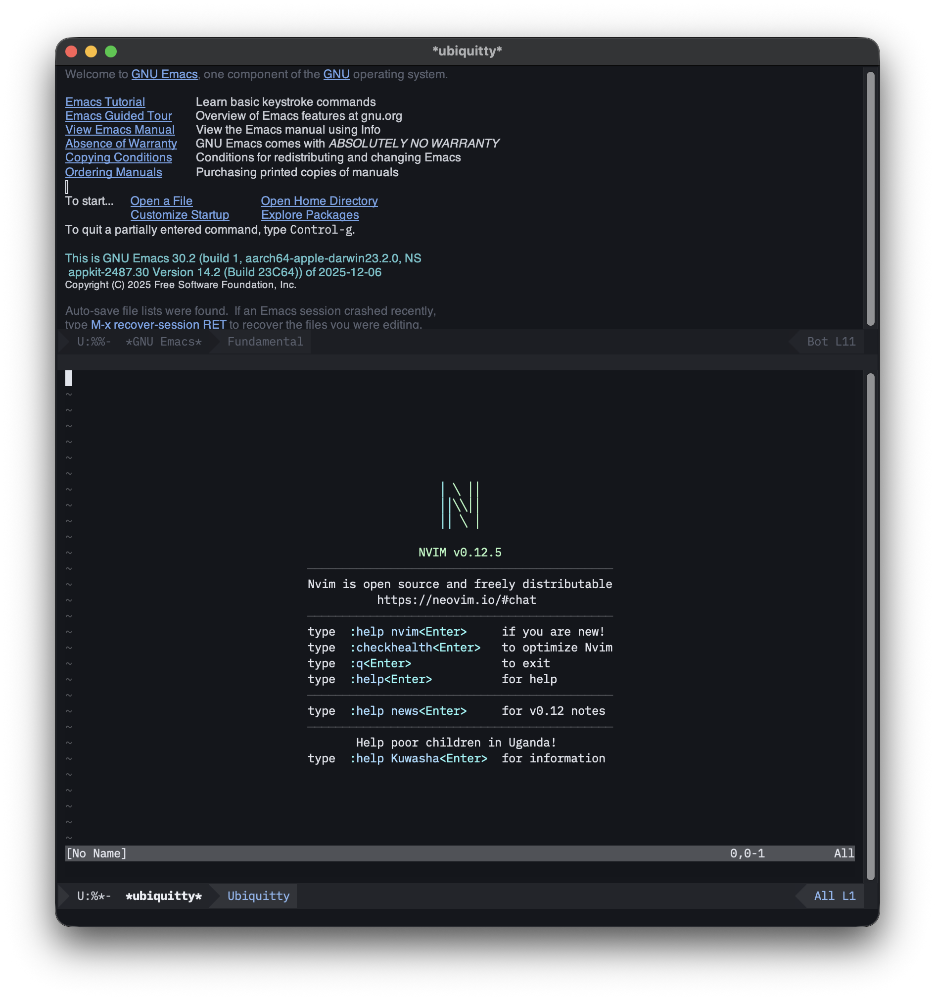

<!-- Copyright (C) 2026 Stanislav Yaglo -->
<!-- SPDX-License-Identifier: MIT -->

# ubiquitty-sync.el

An **Emacs frontend for the Ubiquitty terminal**. It attaches through
`ubiquitty-host --attach`, renders the terminal grid into an Emacs buffer,
and forwards keyboard and mouse input to the session.

The terminal Core (VT parser, screen model, scrollback) runs in the daemon —
**not** in Emacs. A session can outlive Emacs while the host keeps running,
and multiple clients can attach to it. This client displays the current screen,
not the host's scrollback. Inline images require a graphical frame; see
[Rendering](#rendering) and [Limitations](#limitations).



*Neovim running inside Ubiquitty inside Emacs GUI.*

## Requirements

- Emacs 27.1+
- The `ubiquitty-host` daemon binary of the same version as the client. An app
  installed in `/Applications` includes it at
  `/Applications/Ubiquitty.app/Contents/Helpers/ubiquitty-host`, and each
  release publishes it for Linux and Mac servers
  ([Hosting](../../../Docs/auto-update.md#hosting)).

### Build the daemon

To build it instead, from the repository root:

```sh
./Scripts/build-host.sh
ubq_build_root=$(python3 Scripts/build_root.py .)
printf '%s\n' "$ubq_build_root/host/ubiquitty-host"
```

Put the binary somewhere `ubiquitty-sync` can find it. Either:

- add the printed binary's directory to your `PATH` (or symlink it into a `bin/`
  dir on `PATH`), **or**
- set `ubiquitty-sync-host-program` to its absolute path (see below).

## Install

### Manual

```elisp
(add-to-list 'load-path "/path/to/ubiquitty/Source/Platform/Emacs")
(require 'ubiquitty-sync)
```

### `use-package` + a local path

```elisp
(use-package ubiquitty-sync
  :load-path "/path/to/ubiquitty/Source/Platform/Emacs"
  :custom
  ;; Only needed if the daemon is not on PATH:
  (ubiquitty-sync-host-program "/absolute/path/to/ubiquitty-host"))
```

### MELPA-style recipe

The files live under `Source/Platform/Emacs/`, so a recipe needs `:files`:

```elisp
(ubiquitty-sync
 :fetcher github
 :repo "ubiquitty/ubiquitty"
 :files ("Source/Platform/Emacs/ubiquitty-sync.el"
         "Source/Platform/Emacs/ubiquitty-sync-effects.el"
         "Source/Platform/Emacs/ubiquitty-sync-wire.el"))
```

(The daemon binary is still an external prerequisite — the recipe only ships
the Elisp.)

## Usage

```
M-x ubiquitty-sync
```

By default this starts the daemon on demand (`--ensure-daemon`, a no-op if one
is already running), spawns `ubiquitty-host --attach` as the connection, and
opens a `*ubiquitty*` terminal buffer. The window size becomes the terminal
size; resizing the window resizes the session.

The bridge, not a raw socket, because the daemon admits a tokenless local
client only when the kernel names its peer binary as `ubiquitty-host` or the
Ubiquitty app; a direct connection from Emacs is refused as an unauthenticated
agent. The bridge also attaches to its own binary's daemon, so the client and
the daemon it talks to always come from the same build. The host bundled with
the app is `/Applications/Ubiquitty.app/Contents/Helpers/ubiquitty-host`.

To byte-compile from the repository root:

```sh
emacs --batch -L Source/Platform/Emacs -f batch-byte-compile \
  Source/Platform/Emacs/ubiquitty-sync-wire.el \
  Source/Platform/Emacs/ubiquitty-sync-effects.el \
  Source/Platform/Emacs/ubiquitty-sync.el
```

`ubiquitty-sync-wire.el` holds the numbers the client shares with the host.
It is written from the host's headers by `Scripts/gen-wire-tables.py`; change
a header and run the script, never the file.

Keys are forwarded to the terminal, except `C-c`, the **escape prefix** for
Emacs-side commands. Use `C-c C-c` to send a literal Control-C:

| Key        | Action                                  |
|------------|-----------------------------------------|
| `C-c C-q`  | Detach (the session keeps running)      |
| `C-c o`    | `other-window`                          |
| `C-c C-c`  | Send a literal `C-c` (SIGINT)           |

Mouse clicks, drags, and the wheel are forwarded as terminal mouse reports when
the running program has mouse tracking on (e.g. `vim`, `htop`, `mc`); otherwise
they act locally.

The session is coloured with your Ubiquitty theme: the host owns a session's
palette and reads no configuration, so the client sends the palette of the
theme named by `theme` in `~/.config/ubiquitty/config.toml` (or
`ubiquitty-sync-theme`) right after the handshake. The colours come from the
tree's `builtin-themes.toml` when the package is loaded from a checkout
(`ubiquitty-sync-theme-file`); a copy installed elsewhere knows the Noir pair.

When the shell exits, the host ends the session and the buffer is killed
(`ubiquitty-sync-kill-buffer-on-exit`); set it to nil to keep the buffer with
a note instead. The window is displayed before the handshake, so the session
starts at the window's real size, and a resize reaches the host only when the
size changed.

## Customization

| Variable                      | Default          | Meaning                                                             |
|-------------------------------|------------------|---------------------------------------------------------------------|
| `ubiquitty-sync-host-program` | `"ubiquitty-host"` | Name or absolute path of the daemon binary (`executable-find`).   |
| `ubiquitty-sync-auto-start`   | `t`              | Run `--ensure-daemon` before attaching.                             |
| `ubiquitty-sync-socket`       | `nil`            | Socket leaf name for `--attach --socket`; `nil` is the host program's own daemon. |
| `ubiquitty-sync-theme`        | `nil`            | Theme to colour the session with; `nil` reads the config's `theme`, then Noir. |
| `ubiquitty-sync-theme-file`   | tree table       | Path of `builtin-themes.toml`; `nil` knows only the Noir pair.        |
| `ubiquitty-sync-kill-buffer-on-exit` | `t`       | Kill the buffer when the session ends.                              |
| `ubiquitty-sync-clipboard-write-function` | `nil` | Explicit local handler for authorized remote clipboard writes; disabled by default. |
| `ubiquitty-sync-state-directory` | `ubiquitty-sync/` under `user-emacs-directory` | Where the client instance and the resume record are kept. |

### Restarting Emacs

The client keeps its client instance and a resume record in
`ubiquitty-sync-state-directory`, a directory only its owner can open. When
Emacs exits without detaching, the record holds the attachment and the screen
the buffer showed. `M-x ubiquitty-sync` after a restart draws that screen
before the bridge starts, greets the host as the same client, and continues
the attachment: the host sends what changed rather than a whole screen. The
host program reads and writes the record (`ubiquitty-host resume-record`);
the record format and its rules are Core's (Docs/sync.md §6.9). Detaching
with `C-c C-q`, or the session ending, removes it. The record is not
encrypted: it holds what the local daemon's own screen holds, under the same
account.

### Remote clipboard writes

Remote writes require an explicitly configured local handler. The handler
receives `(buffer items)`: the exact protocol clipboard selector and an ordered
list of `(mime . unibyte-data)` pairs. Empty `items` means clear that selector.
It must preserve binary data and all MIME items, or refuse the whole write; the
client does not install a text-only fallback. Return exactly `t` after applying
the write, or `nil` to refuse it. The callback is synchronous and must not retain
or mutate the borrowed items.

Only the authenticated human primary can receive a clipboard write. Transferred
content is bounded and verified before the handler runs. The operation is
consumed before invoking the callback to prevent replay after reconnect. A
disabled or refusing handler records that outcome, not a successful clipboard
write; a handler error closes the carrier. Clipboard contents are excluded from
recent-effect records and status messages.

## Noir theme

`ubiquitty-noir-theme.el` uses the "Noir" palette from
`Source/Core/Themes/builtin-themes.toml`. It supplies the sixteen ANSI colours
to `ansi-color`, `term`, and `eshell`, with related colours for editor surfaces
such as the mode line, current line, selection, and diff backgrounds.

```elisp
(add-to-list 'custom-theme-load-path "/path/to/ubiquitty/Source/Platform/Emacs")
(load-theme 'ubiquitty-noir t)
```

The colours are written as `#rrggbb`; a truecolor terminal shows them exactly
in `emacs -nw`, and the host exports `COLORTERM=truecolor` so an Emacs inside
a Ubiquitty session does.

## Terminal width in `emacs -nw`

In a terminal (`emacs -nw`), Emacs reserves the rightmost screen column for the
line wrap/truncation glyph, so the usable terminal width is one column less than
the frame. In graphical Emacs, that glyph occupies the fringe instead.

## Rendering

The client keeps a local screen model. A checkpoint, checked against its
SHA-256, replaces both screens the client holds; each update replaces the rows
it names, and only the rows that moved on the shown screen are laid out and
inserted again. The client acknowledges applied state. An update
onto a generation the screen does not hold, or one that fails to decode, asks
the host for a fresh checkpoint (`Resync`). A palette, reverse-video or
text-size change lays every row out again from the records the client keeps.

Images (kitty, sixel, iTerm) arrive as chunks of zlib-compressed pixels. On a
graphical Emacs with zlib support, each row a placement covers shows a slice
of the image as a display property over the
covered cells, so the picture moves and scrolls with the text under it. With PNG
support, source crops and RGBA transparency are preserved. A placement with both cell dimensions
uses that box; with neither dimension it keeps its source pixel size, padded
transparently to whole cells. Whole-cell components of pixel offsets move the
placement. Builds without PNG support retain opaque RGB images through PPM,
including source crops, but cannot show RGBA or add transparent padding.
No external image helper is used. A terminal Emacs draws no images.

A double-width row (DECDWL) shows its first half with a space after each cell
in the cell's colours. The top row of a double-height pair (DECDHL) is drawn
the same way at twice the face height on a graphical display, and the bottom
row is blank with its line folded into the top; a terminal Emacs draws the
top row double-width and the bottom row blank.

Cells display their grapheme clusters, including combining marks and emoji
sequences. Proportional runs use their recorded text and cell span. Frames
received in one read are applied as a batch, painted once, and acknowledged
once.

## Limitations

- No scrollback view or `OSC 8` link activation.
- No consent flow or remote (QUIC) transport.
- A kitty image placed by Unicode placeholders draws as blank cells.
- Image slices replace the covered text: they do not implement behind-text
  z-order, compositing of overlapping placements, or sub-cell pixel offsets.
  A placement specifying only one cell dimension is not drawn. Transparent
  pixels reveal the buffer background, not the replaced terminal text.

## License

MIT. See [LICENSE](LICENSE).
